# MASTER_ARCHITECTURE.md — 1Crypten 7.7.7 (V177)

Fonte unica de verdade arquitetural. Extraido diretamente do codigo-fonte (nao de historico de versoes).
Este e o unico documento de arquitetura do projeto — o Hermes le os primeiros ~8000 caracteres deste arquivo em cada resposta (`hermes_agent.py:_load_architecture_context`), portanto os fatos mais criticos ficam no topo.

*Verificado contra o codigo em 2026-10-27. VERSION no codigo: `backend/main.py` VERSION="V177-COMPOUND-LADDER-SOVEREIGN-FLEET" / DEPLOYMENT_ID="V177_SOVEREIGN_LAYA_COMPOUND". Integracao do Motor de Mapa de Calor de Liquidacoes Coinglass + OKX Deep L2 (coinglass_heatmap_service.py), Extirpacao Definitiva da Contratendencia Cega (desativacao permanente de LAYA_DVWAP_REVERSION), Novo Setup Soberano LAYA_LIQUIDITY_HUNT com Imas de Liquidacao de Baleia (BULLISH_SWEEP / BEARISH_SWEEP), Veto Absoluto de Ima de Liquidez (proibido abrir SHORT com muralha de liquidacao acima), Blindagem Microestrutural 5M sem falsos positivos e Nova Interface Laya 360 com Canvas Nativo de Liquidacao em Tempo Real.*

---

## 1. Visao Geral

1Crypten e um sistema de trading automatizado para criptomoedas na OKX. Roda um app FastAPI unico (`backend.main:app`) que executa em paralelo o motor real e dois laboratorios de forward-testing (Scalping Lab e Swing Lab).

- **Entry point (unico)**: `uvicorn backend.main:app --host 0.0.0.0 --port $PORT` (Procfile / railway.json / Dockerfile). **Nao existe `main.py` na raiz.**
- **Backend**: FastAPI (Python 3.12-slim)
- **Frontend & Design System**: HTML/JS standalone no padrão **Binance Design System** (`#0B0E11` Deep Canvas, `#1E2329` Cards, `#2B3139` Borders, `#FCD535` Iconic Yellow, `#0ECB81` Green, `#F6465D` Red) integrado com o motor matemático de **Thinking Orbs** em 15 pontos estratégicos da UI (`backend/app/static/cockpit.html`, `frontend/cockpit.html`, `hermes.html`, `market.html`, `mobile_app.html`).
- **Exchange**: OKX (SWAP / Portfolio Margin). Modo `PAPER` (simulado) ou `REAL`, via `OKX_EXECUTION_MODE`.
- **[V127/V145/V165/V166] Semantica PAPER vs REAL (espelho do Cockpit)**: Em **PAPER**, o Cockpit (`cockpit.html`) representa o **Sandbox** — tanto o *Net Worth* (Banca Simulada Consolidada via `get_sandbox_unified_balance`) quanto o *Painel de Custodia* (ordens ativas do Scalping Lab / Day Trade). Em **REAL**, a OKX recebe as ordens scalping/swing do Sandbox (via `SWING_MIRROR_MODE`/espelhamento) e o Cockpit representa a banca real da OKX. Ver Secao 8.6.
- **Plataforma**: Railway + Docker
- **Persistencia & Memória Unificada**: PostgreSQL (SSOT) + Firebase (Firestore/RTDB) + SQLite WAL (`local_sniper.db`) + Obsidian Vault (`vault_galaxy/` para voz, chat e diários).
- **[V168] Banco de Dados de Contexto OpenViking (`viking://`)**: Sistema de arquivos virtual cognitivo com Progressive Disclosure em 3 camadas: L0 (Abstract executivo ~100 tokens), L1 (Overview operacional ~1.5k tokens) e L2 (Detail completo). O Hermes e os agentes de desenvolvimento navegam deterministicamente pelas raízes `viking://resources/`, `viking://user/memories/` e `viking://agent/skills/`.
- **Memória Auto-Evolutiva de Trading**: Ao fechar qualquer trade (Stop, TP, Trailing Stop ou Emergência), o sistema sintetiza automaticamente o caso em `viking://user/memories/cases/` e persiste no Obsidian Vault (`vault_galaxy/journal/`), eliminando a necessidade de o operador humano lembrar o sistema de regras ou erros passados.
- **Protocolos de IA & RAG**: OpenViking Context Engine + RAG Semântico (`RAGService`), Model Context Protocol (`mcp_bridge.py` MCP 2.x - 14 Ferramentas), Consciência Laya (laya-multilingual CPU) e Hermes Intelligence Orchestrator.
- **Precisão & Quantização Inviolável**: Motor `OKXUniverseService` com suporte a 507 pares perpétuos da OKX, garantindo tick size exato (`format_price_by_tick`), lot size e quantização correta de contratos (`quantize_order_contracts`).
- **Tríplice Confluência Alt Pump Ignition**: Motor institucional que detecta rotação do BTC para Altcoins (`evaluate_alt_pump_ignition`), cruzando queda de BTC.D, correlação Pearson < 0.45 e expansão algorítmica `1c_exp >= 70.0`.

### 1.1 Diagrama de Arquitetura do Sistema

```mermaid
flowchart TD
    subgraph Frontend["Frontend Client (Binance Design & Thinking Orbs)"]
        UI_Cockpit["cockpit.html (Binance Dark #0B0E11 + 15x Thinking Orbs + 8 Slots Day Trade)"]
        UI_Charts["4 Quadrant Grid Charts (LightweightCharts + Weaving Orbs)"]
        UI_LayaHUD["Laya Sovereign Mind Stream & Solving Orbs"]
        UI_Screener["Screener Modal (Universal 507 Pares / 30 Titãs)"]
    end

    subgraph API_Routers["FastAPI Routers (backend.main:app:8085)"]
        R_Slots["/api/slots (Active Trades Mirror - 8 Slots Cap)"]
        R_State["/api/sandbox/unified-state (Equity & Net Worth)"]
        R_Pulse["/api/radar/pulse & /api/v1/hermes/laya/pulse"]
        R_Kronos["/api/v1/hermes/laya/kronos-projection"]
        R_Viking["/api/v1/hermes/viking/tree, /read, /search, /sync & /commit-lesson"]
        R_RAG["/api/v1/hermes/rag/search & /status & /reindex"]
        R_ML["/api/v1/ml/status & /dataset-stats & /generate-dataset"]
        R_Intel["/api/v1/market/screener-matrix & /ai-context (1C-EXP & 1C-RANGE)"]
        R_Precision["/api/v1/market/contract-specs (TickSz & LotSz Audit)"]
        R_Heatmap["/api/v1/hermes/laya/liquidation-heatmap (Coinglass Matrix & Whale Magnet)"]
        R_Heatmap["/api/v1/hermes/laya/liquidation-heatmap (Coinglass Matrix & Whale Magnet)"]
    end

    subgraph Protocol_Bridges["Protocol & AI Bridges"]
        MCP_Bridge["MCP 2.x Starlette Mount (/mcp/sse, /mcp/tools - 14 Ferramentas)"]
        OpenViking_Engine["OpenViking Context Engine (viking:// Virtual FS - L0/L1/L2 Progressive Disclosure)"]
        RAG_Engine["RAGService (BM25 / TF-IDF Second Brain: Blueprints + Vault)"]
    end

    subgraph Decision_Engines["Tactical & Decision Engines"]
        LayaRouter["LayaRouterService (Sovereign Whale/Retail Hunter + Calibrated Weights)"]
        AltPump["AltPumpIgnition Engine (Triple Confluence: BTC.D Drop + Pearson < 0.45 + 1C-EXP >= 70)"]
        BTCSpecialist["LayaBTCSpecialist (BTC.D Matrix, Lead-Lag Spot x Swap, Macro Climate)"]
        SignalGen["SignalGenerator (Pearson 15h/4h Return Correlation & Decorrelation Hunter)"]
        Kronos["KronosScorer (AAAI 2026 Temporal Trajectory)"]
        LayaFlow["LayaFlowService (OKX Rubik LSR & OI Delta)"]
        OKXUniverse["OKXUniverseService (507 Pares OKX + TickSz/LotSz/CtVal Engine)"]
        MarketIntel["MarketIntelEngine (Universal Screener 507 Pares, 1C-EXP, 1C-RANGE)"]
        StopLadder["OrderProjectionService (Never Give Back Trailing Ladder)"]
        SanityGate["Price Sanity & Structural ATR Stop Gate (1.8% - 3.5%)"]
        CoinglassHeatmap["CoinglassHeatmapService (Liquidation HeatMap Matrix & Whale Magnet Vector)"]
        CoinglassHeatmap["CoinglassHeatmapService (Liquidation HeatMap Matrix & Whale Magnet Vector)"]
    end

    subgraph Sandbox_Labs["Dual-Engine Execution Labs"]
        ScalpLab["SandboxService (Day Trade H1 / 8 Slots - $100 Margin Each)"]
        SwingLab["SandboxSwingService (Swing Lab - Paused / SWING_SCAN_ENABLED=False)"]
    end

    subgraph Ingestion_Layer["Market Ingestion Layer"]
        OKX_WS["OKXWSPublic (Live WS Tickers, Extreme Low/High 120s)"]
        OKX_REST["OKXRest (Batch 507 SWAP Tickers & Contract Instruments)"]
        CoinGecko["CoinGecko/CoinCap API (Global BTC.D Live Oracle)"]
    end

    subgraph Data_Layer["Data & Persistence Layer"]
        DB_SQLite["SQLite WAL (local_sniper.db)"]
        DB_Postgres["PostgreSQL (Production SSOT)"]
        DB_Firebase["Firebase RTDB / Firestore (Mirroring)"]
        DB_Galaxy["Obsidian Vault (vault_galaxy)"]
        Docs_Blueprints["Blueprints (docs/blueprint/ 01 a 09)"]
    end

    UI_Cockpit --> R_Slots
    UI_Cockpit --> R_State
    UI_Cockpit --> R_Pulse
    UI_Cockpit --> UI_Screener
    UI_Charts --> R_Kronos
    UI_Screener --> R_Intel

    MCP_Bridge --> ScalpLab
    MCP_Bridge --> DB_SQLite
    MCP_Bridge --> RAG_Engine
    MCP_Bridge --> MarketIntel
    MCP_Bridge --> OKXUniverse
    R_RAG --> RAG_Engine
    RAG_Engine --> DB_Galaxy
    RAG_Engine --> Docs_Blueprints

    R_Slots --> ScalpLab
    R_State --> DB_SQLite
    R_Pulse --> LayaRouter
    R_Intel --> MarketIntel
    R_Precision --> OKXUniverse

    LayaRouter --> AltPump
    LayaRouter --> BTCSpecialist
    LayaRouter --> SignalGen
    LayaRouter --> OKXUniverse
    LayaRouter --> MarketIntel
    AltPump --> BTCSpecialist
    AltPump --> SignalGen
    AltPump --> MarketIntel
    LayaRouter --> LayaFlow
    LayaRouter --> Kronos
    LayaRouter --> RAG_Engine
    LayaRouter --> SanityGate
    LayaRouter --> CoinglassHeatmap
    R_Heatmap --> CoinglassHeatmap
    LayaRouter --> CoinglassHeatmap
    R_Heatmap --> CoinglassHeatmap
    SanityGate --> ScalpLab

    CoinGecko --> BTCSpecialist
    OKX_WS --> ScalpLab
    OKX_WS --> LayaRouter
    OKX_REST --> OKXUniverse
    OKX_REST --> MarketIntel

    ScalpLab --> StopLadder
    ScalpLab --> OKXUniverse
    ScalpLab --> DB_SQLite
    DB_SQLite -.-> DB_Postgres
```



---

## 2. Constantes Principais (fonte: `backend/config.py`)

| Constante | Valor | Fonte |
|-----------|-------|-------|
| `LEVERAGE` (Laya Soberana) | 15x ou 20x (Exclusivamente 15x ou 20x) | `laya_router_service.py` / V172 |
| `LEVERAGE` (Altcoins Geral) | 15x (Cross) | `okx_universe_service.py` / Dossiê dos 10 Titãs |
| `LEVERAGE` (BTC / ETH) | 30x (Cross) | `okx_universe_service.py` / Dossiê dos 10 Titãs |
| `MAX_SLOTS` (cap global) | 20 | `config.py:124` |
| `MAX_SLOTS_LATERAL` | 16 | `config.py:125` |
| `MAX_SLOTS_TRENDING` | 16 | `config.py:126` |
| `MARGIN_PER_TRADE` (Laya) | $100.00 (8 slots = $800 alocado / 8.0% banca) | `sandbox_service.py` / V165 |
| `RISK_CAP_PERCENT` | 0.08 (8.0% da banca em 8 slots de $100) | `config.py:132` / V165 |
| `STRUCTURAL_STOP_DIST` | 1.8% a 3.5% de preço (Buffer anti-sweep H1) | `laya_router_service.py` / V165 |
| `MAX_SCALP_SLOTS` | 8 Slots Simultâneos | `sandbox_service.py` / V165 |
| `STOP_LOSS_QUARANTINE` | 7200s (2 Horas Anti-Reincidência) | `laya_router_service.py:885` / V159 |
| `WHITELIST_TITANS_30` | Top 30 Altcoins de Elite Institucional (Sem BTC para trade) | `okx_universe_service.py:42` / V160 |
| `BTC_ROLE` | Oráculo Macro Exclusivo (Zero trades em BTC) | `laya_router_service.py:785` / V160 |
| `RISK_ZERO_TRIGGER_ROI` | +8.0% → +1.0% ROI (Garantia Taxas) | `sandbox_service.py:1610` / V159 |
| `ADX_MIN_ENTRY` | 22 | `config.py:142` |
| `ADX_TRENDING_THRESHOLD` | 25 | `config.py:144` |
| `ADX_STRONG_TREND_THRESHOLD` | 30 | `config.py:146` |
| `SWING_SCAN_ENABLED` | **False (PAUSADO / GATE SOBERANO)** | `config.py:166` / V146 |
| `MCP_MOUNT` | `/mcp` (`/mcp/sse`, `/mcp/tools`) | `backend/main.py:806` / V144 |
| `RAG_ROUTER` | `/api/v1/hermes/rag` (`/search`, `/status`) | `backend/routes/rag_routes.py` |
| `ML_ROUTER` | `/api/v1/ml` (`/status`, `/dataset-stats`) | `backend/app/api/v1/endpoints/ml.py` |

### 2.1 Motor Soberano Laya V160 (Metodologia Encryptos: Top 30 Altcoins & BTC Oráculo)
1. **Top 30 Altcoins de Elite Institucional da OKX**:
   - `ETH`, `SOL`, `NEAR`, `SUI`, `AVAX`, `ADA`, `XRP`, `LINK`, `DOT`, `SEI`, `TON`, `ARB`, `OP`, `ZK`, `XPL`, `POL`, `UNI`, `AAVE`, `MKR`, `PYTH`, `ONDO`, `INJ`, `PENDLE`, `RENDER`, `FET`, `TIA`, `ICP`, `AR`, `DOGE`, `LTC`.
   - Proibido varrer pares ruidosos, memecoins ilíquidas ou ativos de baixa capitalização.
2. **BTC como Oráculo Macro Exclusivo (Zero Trades no BTC)**:
   - Monitoramento contínuo de `BTC-USDT` (Spot) vs `BTC-USDT-SWAP` (Perpétuo) para capturar o *Lead-Lag* institucional.
   - O BTC atua como a bússola/farol de tendência e dominância, sendo estritamente vetado para abertura de posições de trade para concentrar o capital e os 15x de alavancagem na assimetria elástica das altcoins.
3. **Matriz de Clima por Dominância do Bitcoin (BTC.D) e Farol Macro**:
   - `ALTCOIN_EXPANSION`: BTC.D em queda (< 56.5% ou FALLING) + BTC estável/positivo -> Compras agressivas (LONG) em 15x liberadas; Vendas (SHORT) vetadas.
   - `ALTCOIN_BLOODBATH`: BTC.D subindo (>= 58.5% ou RISING) + BTC em queda (< -1.0%) -> Veto total de compras (LONG); Apenas SHORTS autorizados a favor da sangria.
   - `BTC_DRAINAGE`: BTC positivo (>= +0.3% ou trend bias positivo) com Dominância elevada (>= 59.0% ou RISING) -> O Bitcoin atua como sucção de liquidez: VETO TOTAL DE SHORTS EM ALTCOINS (proibido shortar altcoins no rali do BTC).
   - `CONSOLIDATION_CHOP`: Mercado lateral -> Caça de liquidez em extremidades. Se BTC.D >= 58.0% e BTC > +0.2%, SHORTs em altcoins também são preventivamente vetados.
4. **Tríade de Blindagem Institucional da Laya (V162)**:
   - **Circuit Breaker Global Anti-Tilt**: Se 3 stops quaisquer ocorrerem em janela de <= 90 minutos (5.400s), todas as novas aberturas são congeladas por 45 minutos (2.700s), resfriando a banca contra liquidações de mercado.
   - **Descorrelação Setorial entre os 4 Slots**: Carteira dividida em 5 clusters (`L1_BLUECHIP`, `L2_ROLLUPS`, `DEFI_ORACLE`, `AI_DEPIN`, `MEME_SPEC`). Limite rígido de no máximo 2 posições simultâneas do mesmo cluster para evitar drawdown de ativos correlacionados.
   - **Confirmação de Agressão / CVD no Suporte/Resistência**: Toques em suportes H1 com agressão vendedora violenta (`taker_sell_ratio >= 1.40x`) são vetados por *Faca Caindo*. Toques em resistências com agressão compradora (`taker_buy_ratio >= 1.40x`) são vetados por *Pressão Compradora Ativa*.
5. **Quarentena Rígida Anti-Reincidência (2 Horas)**:
   - Todo ativo que sofrer Stop Loss entra em quarentena inegociável de 7200 segundos (2h), impedindo perdas repetidas no mesmo par.
6. **Stops Estruturais de Borda H1 (Eliminação de Ruído)**:
   - Distância de Stop Loss ancorada em `max(0.028, min(0.045, (atr_pct * 1.8) / 100.0))`.
   - Stops calibrados para 2.8% a 4.5% fora da acumulação, eliminando violinadas de 15 segundos causadas por micro-ruído de spread.
   - `stop_roi` calibrado proporcionalmente à alavancagem (`calculate_roi`), eliminando o bug de capping a -3.5% ROI que correspondia a -0.23% de preço.
6. **Hierarquia Integrada de 4 Setups Soberanos da Laya (V161)**:
   - **Camada 1: Saída de Acumulação H1 (`LAYA_SMART_MONEY_H1`)**: Rompimento com volume e expansão para fora da faixa de consolidação de 1H, confirmado por capital novo (`OI Delta > +0.5%`) e proporção favorável de baleias (`LSR <= 1.15` em LONG ou `>= 1.25` em SHORT).
   - **Camada 2: Reversão nos Extremos da Faixa (`LAYA_RANGE_REVERSAL`)**: Atua diretamente nos regimes de `CONSOLIDATION_CHOP` / `MEAN_REVERSION` (ADX < 25). Quando o preço testa o piso (`pos <= 25%` ou a menos de 1.5% do suporte H1), dispara **LONG** de absorção com Stop Loss estrutural abaixo do suporte. Quando o preço testa o teto (`pos >= 75%` ou a menos de 1.5% da resistência H1), dispara **SHORT** de exaustão contra o varejo em FOMO.
   - **Camada 3: Momento Mola 15M (`LAYA_MOMENTO_MOLA`)**: Detecta compressão extrema de volatilidade das Bandas de Bollinger (`bb_width_pct <= 6.5%`) nos extremos de canal de 15 minutos, armando disparos elásticos direcionais com proteção contra fundos falsos.
   - **Camada 4: DVWAP Reversion 5M (`LAYA_DVWAP_REVERSION`)**: Opera desvios elásticos contra a VWAP intradiária (`diff_pct >= 1.5%`), ancorada no preço típico ponderado por volume `(High + Low + Close) / 3`, vetando compras contra quedas do Bitcoin e protegendo contra taxas adversas via Funding Shield.
7. **Motor de Projeção & Singleton SSOT**:
   - `order_projection_service.py` padronizado como singleton único (`order_projection_service`) com alias canônico `proj_service`, unificando a projeção de ROI, cálculo de Stops escalonados (Never Give Back) e metadados de execução para o Sandbox e Cockpit.

8. **Invariante de Alavancagem Obrigatória (15X a 20X) [V172]**:
   - Todas as ordens autônomas abertas pela Laya Soberana operam **exclusivamente em 15x ou 20x** (sem valores intermediários).
   - Proibição Absoluta: Nenhuma ordem pode ser aberta com alavancagem inferior a 15x (veto irrestrito a 5x, 8x, 9x ou 10x).
   - Clamp Matemático de Execução: `leverage = 20 if (calc_lev >= 18 or chosen.get("score", 0) >= 90) else 15` com `target_stop_roi = 35.0` ancorado na distância estrutural de Stop Loss de preço H1.
   - Compatibilização de Stop ROI: O stop financeiro inicial é mantido proporcionalmente na faixa de -30% a -38% de ROI, garantindo proteção de capital sem encurtar a distância técnica do canal H1.

### 2.2 Radar Universal Encryptos V163 (507 Contratos OKX & Detecção de Ignição de Robôs)
1. **Varredura Universal dos 507 Pares OKX (`market_intel_engine.py`)**:
   - Ingestão atômica de 100% dos contratos perpétuos USDT-SWAP da OKX em única requisição (<300ms).
   - Filtro de higiene institucional: descarta contratos zumbis (volume 24h < $500k USD).
2. **Algoritmo de Aceleração Smart Money (`1C-EXP` & `bot_ignition`)**:
   - Detecta a ativação repentina de robôs institucionais/Market Makers (volume spike 5m, compressão de volatilidade e delta de OI).
   - Ativos com `1C-EXP >= 70` recebem a chancela `bot_ignition = True`.
3. **Controle Integrado por Laya e Hermes**:
   - **Laya**: Injeta automaticamente as altcoins em ignição institucional na esteira autônoma de execução (`scan_and_execute_autonomous`), validando contra a tríade de blindagem, stops de 2.8% a 4.5% ATR e Never Give Back.
   - **Hermes**: Comando operacional direto no chat para auditar quais robôs estão ligados no mercado hoje, gerando relatórios executivos em tempo real.
4. **UI Cockpit**:
   - Modal do Screener com alternância em 1 clique entre **Universal (507 Pares)** e **Titãs (30)**.

### 2.3 Motor de Precisão e Quantização Inviolável de Contratos OKX (V165)
1. **Dicionário Dinâmico de 507 Especificações Canônicas (`okx_universe_service.py`)**:
   - Carregado na inicialização via `/api/v5/public/instruments?instType=SWAP`.
   - Indexa `tickSz`, `lotSz`, `minSz`, `ctVal` e `ctMult` para cada par.
2. **Quantização Matemática de Preço por Tick Size**:
   - `format_price_by_tick(price, symbol)`: Converte o preço float para o múltiplo exato do `tickSz` do par (ex: BTC com `0.1` -> `82450.1`, PEPE com `0.00000001` -> `0.00000985`).
   - Elimina rejeições de ordem OKX por `Invalid price precision`.
3. **Quantização de Lotes e Contratos por `lotSz` e `ctVal`**:
   - `quantize_order_contracts(notional_usd, mark_price, symbol)`: Converte o valor nocional em dólares para a quantidade exata de contratos inteiros ou fracionários permitidos.
   - Trata automaticamente memecoins com `ctVal = 10.000.000` (ex: PEPE) e pesos-pesados com `ctVal = 0.01` (ex: BTC).
4. **Governança Hermes e MCP 2.x**:
   - Ferramenta MCP `get_contract_precision_audit(symbol)` disponível para agentes externos e Claude Desktop.
   - Comando `auditar contrato <SIMBOLO>` no Hermes para inspeção operacional instantânea pelo trader.

**Status Operacional Atual [V165-UNIVERSAL-ENCRYPTOS-PRECISION]**:
- **Scalping Lab (Laya Soberana)**: 100% ativo com alavancagem de **15x**, stops de -7.5% ROI e trailing stop Never Give Back (50% do pico de lucro).
- **Swing Lab**: Pausado soberanamente (`SWING_SCAN_ENABLED=False`) para estancar drawdown e concentrar 100% dos slots e capital no Scalping.
- **RAG & MCP**: RAG indexando blueprints 01 a 09 e cofre Obsidian; MCP 2.x montado nativamente em `/mcp` com 10 ferramentas registradas.
- **Precisão OKX**: 100% dos 507 pares quantizados e formatados matematicamente.

> **[V127] Saldo exibido em PAPER**: `OKX_SIMULATED_BALANCE` e a base do Guardiao/sizing em PAPER, mas o *Net Worth* do Cockpit em PAPER NAO e `OKX_SIMULATED_BALANCE` — e a **Banca Simulada Consolidada do Sandbox** (`get_sandbox_unified_balance`, `database_service.py`: `BANCA_BASE` $10.000 + Σ(pnl_pct/100 × $200) sobre TODOS os trades Scalp+Swing). Ver Secao 8.6.

> Nota: `bankroll.py` le `settings.MARGIN_PER_TRADE_*` (0.50) e `settings.MAX_SLOTS_*` (16). Comentarios legados em `bankroll.py` citam "$2.00/$1.00" e "20/40" — esses valores NAO refletem o config atual.

---

## 3. Escadinha de Stops (fonte: `backend/services/order_projection_service.py` + `sandbox_service.py` + `sandbox_swing_service.py`)

Existem **6** escadas. A selecao e feita em `get_stop_ladder(roi, is_ranging, slot_type, strategy_class)`:
- `is_swing` = `slot_type` in (BLITZ_30M, SWING) **ou** `strategy_class` in (VELOCITY FLOW, ALPHA SHIELD, DECOR SHADOW, LAYA_SMART_MONEY_H1)
- `is_scalping` = `strategy_class`=="VWAP SNIPER" **ou** `slot_type`=="SCALPING"
- `is_laya_reversion` = `strategy_class`=="LAYA_MEAN_REVERSION"
- `is_smart_money_h1` = `strategy_class`=="LAYA_SMART_MONEY_H1" (Metodologia Encryptos: Acumulação H1, Rompimento com força, Confirmação LSR x OI, Stop Loss na borda de saída da consolidação).
- Roteamento: swing+ranging→`SWING_LATERAL` · swing→`SWING` · laya_reversion→`LAYA_REVERSION` · scalping→`SCALPING` · ranging→`RANGING` · senao→`TRENDING`.

### 3.1 `ORDER_STOP_LADDER_RANGING` (lateral scalping padrao)
| Gatilho ROI | Stop ROI | Nome | Status |
|---|---|---|---|
| 8% | 2% | GARANTIA_TAXAS | RISCO_ZERO |
| 12% | 5% | GARANTIA_LUCRO_CURTO | RISCO_ZERO |
| 20% | 10% | GARANTIA_LUCRO_MEDIO | RISCO_ZERO |
| 32% | 18% | GARANTIA_LUCRO_ALTO | RISCO_ZERO |
| 50% | 48% | ALVO_MAXIMO_LATERAL | PROFIT_LOCK |
Acima de 20% ROI em ranging, a escada sobe dinamicamente de 1% em 1% (trailing gap 5%, ou 10% se `slot_type=BLITZ_30M`).

### 3.2 `ORDER_STOP_LADDER_SCALPING` (VWAP SNIPER) [V146]
| Gatilho | Stop | Nome | Status |
|---|---|---|---|
| 10% | 2% | GARANTIA_TAXAS_SCALP | RISCO_ZERO |
| 18% | 8% | LUCRO_CURTO_SCALP | RISCO_ZERO |
| 30% | 18% | LUCRO_MEDIO_SCALP | PROFIT_LOCK |
| 45% | 32% | TRAILING_SCALP | PROFIT_LOCK |

### 3.3 `ORDER_STOP_LADDER_LAYA_REVERSION` (Laya Mean Reversion) [V147-WINRATE]
Calibração específica para reversões em consolidação com alavancagem 15x e Early Shield. Protege trades que andaram a favor antes do breakeven (evitando devoluções como no caso da ARB) e garante assimetria de retorno positiva:
| Gatilho ROI | Stop ROI | Nome | Status |
|---|---|---|---|
| 4.0% | -2.0% | EARLY_SHIELD_LAYA | RISCO_BAIXO (Corta 73% do risco inicial) |
| 6.0% | 1.5% | GARANTIA_TAXAS_LAYA | RISCO_ZERO |
| 12.0% | 6.0% | LUCRO_CURTO_LAYA | PROFIT_LOCK |
| 22.0% | 14.0% | LUCRO_MEDIO_LAYA | PROFIT_LOCK |
| 35.0% | 24.0% | PROFIT_LOCK_LAYA | PROFIT_LOCK |
| 50.0% | 38.0% | ALVO_MAXIMO_REVERSION | PROFIT_LOCK |

### 3.4 `ORDER_STOP_LADDER_SWING` (swing tendencia - V146 2H 50x)
Protege lucros contra devolução total (impede que trades de +30% voltem para o zero a zero):
| Gatilho | Stop | Nome | Status |
|---|---|---|---|
| 15% | 2% | BREAKEVEN_2H | RISCO_ZERO |
| 25% | 12% | PROTECAO_PARCIAL | RISCO_ZERO |
| 40% | 25% | LUCRO_MEDIO_2H | PROFIT_LOCK |
| 65% | 45% | LUCRO_ALTO_2H | PROFIT_LOCK |
| 100% | 75% | EMANCIPADO_2H | PROFIT_LOCK |
| 200% | 150% | SUPER_TENDENCIA | PROFIT_LOCK |
| 350% | 280% | ALVO_ESTENDIDO_2H | PROFIT_LOCK |

### 3.5 `ORDER_STOP_LADDER_SWING_LATERAL` (swing em lateral)
| Gatilho | Stop | Nome |
|---|---|---|
| 5% | 1.5% | BREAKEVEN_LATERAL |
| 15% | 5% | PRE_UNIT1_LATERAL |
| 30% | 15% | UNIT1_GARANTIDO |
| 60% | 30% | EMANCIPADO_LATERAL |
| 100% | 80% | TRAILING_LATERAL |

### 3.6 `ORDER_STOP_LADDER_TRENDING` (tendencia)
14/2, 25/10, 40/20, 60/40, 80/60, 100/80, 130/110, 150/110, 200/150, 300/220, 400/280, 500/350, 600/420, 700/500, 750/600, 800/650, 1000/800, 1200/1000.
Acima de 1200% ROI (APEX): niveis `ULTRA_*` a cada +200% ROI, stop = gatilho − 200%.

`ORDER_STOP_LADDER` (sem sufixo) e um alias de `TRENDING` para compatibilidade com o compliance do Hermes.

### 3.7 Proteções Adicionais (Scalping/Swing/Laya Sandbox)

**GARANTIA_4 / GARANTIA_6 — Risco Zero Imediato [V133 / V135-RR / V136-SWING / V145]** (`sandbox_service.py:1571-1583`):
Quando `max_roi >= threshold` e `current_stop_roi < 0%`, stop vai a 0% ROI (break-even).
- **Laya Mean Reversion [V145]**: threshold = **+6.0% ROI** → stop sobe imediatamente para **+1.5% ROI** (lucro mínimo garantido contra reversões).
- **Scalping Geral**: threshold = **+4%** (V135-RR).
- **Swing**: threshold = **+12%** (V136-SWING). Breakeven mais alto para dar fôlego ao trade de médio prazo.

**GARANTIA_TRAIL — Trailing Dinâmico [V122 / V131-FIX / V133 / V135-RR / V136-SWING / V145]** (`sandbox_service.py:1588-1645`):
**[V145]** Split por tipo de trade:
- **Laya Mean Reversion**: `max_roi >= 6.0%` → stop = `max(1.5, max_roi × 0.50)` (**50%** do pico, mínimo +1.5%).
- **Swing**: `max_roi >= 12%` → stop = `max(3.0, max_roi × 0.50)` (**50%** do pico, mínimo +3%). Trades duram mais sem dar lucro embora.
- **Scalping Geral**: `max_roi >= 4%` → stop = `max(1.5, max_roi × 0.75)` (**75%** do pico, mínimo +1.5%).
- **Stop Inicial Máximo [V145]**: Capado rigidamente em **-7.5% ROI** (0.50% de variação no preço com 15x de alavancagem), assegurando assimetria R:R $\ge$ 4:1 com alvos de +30% a +36%.
- **Scalping**: `max_roi >= 4%` → stop = `max(1.5, max_roi × 0.75)` (**75%** do pico, mínimo +1.5%). Inalterado.
**[V135-RR]** Apertado de 60% para 75% do pico (Scalping) — avg give-back era 4.0pp.
**[V131-FIX]** Correção de bug crítico: a condição `current_stop_roi < 0.0` impedia o trailing de avançar após a GARANTIA_8 mover o stop para 0%. Removida a condição.
**[V133]** Breakeven de ativação igualado para 8% em ambos modos — antes 12% no Scalping, 8% no Swing. **[V135-RR]** Reduzido para 4% (Scalping). **[V136-SWING]** Swing elevado para 12%.

### 3.7 Equity Defense — Defesa Progressiva de Patrimônio [V128]

Sistema de proteção do saldo consolidado da banca Sandbox. Rastreia o pico da equity e protege
80% do lucro acumulado com stops progressivos por nível.

**Config** (`config.py:193-203`):
- `EQUITY_DEFENSE_LOCK_RATIO = 0.80` — 80% do lucro do pico é protegido
- `EQUITY_DEFENSE_STOP_L1 = 7.0%` — L1 LEVE: stop = pico - 7%
- `EQUITY_DEFENSE_STOP_L2 = 5.0%` — L2 MODERADO: stop = pico - 5%
- `EQUITY_DEFENSE_STOP_L3 = 3.0%` — L3 FORTE: stop = pico - 3%
- `EQUITY_DEFENSE_MIN_ROI = 5.0%` — ROI mínimo do trade para defesa aplicar (evita fechar trades com ROI baixo)

**Níveis de defesa** (`sandbox_service.py:1333-1368`):

| Banca (profit %) | Nível | Ação |
|---|---|---|
| < +3% | 0 OFF | Stop segue escadinha normal |
| +3% a +4.9% | 1 LEVE | Stop = pico - 7% |
| +5% a +9.9% | 2 MODERADO | Stop = pico - 5% |
| >= +10% | 3 FORTE | Stop = pico - 3% |
| abaixo do piso | 4 CRITICO | Fecha todos os trades |

**Piso protegido** (`database_service.py:296-301`):
```
peak = maior saldo já visto
peak_profit = peak - base ($10.000)
floor = base + (peak_profit × 0.80)

Exemplo: peak $10.900 → floor = $10.000 + ($900 × 0.80) = $10.720
```

**Enforcement** (`sandbox_service.py:1497-1527`, `flash_agent.py:507-547`):
- L1/L2/L3: sobe stop para `peak_roi - stop_pct` (só se > stop atual E max_roi >= 5%)
- CRITICO: fecha trade imediatamente com status `CLOSED_EQUITY_DEFENSE`
- Threshold: defesa só aplica quando ROI máximo do trade >= 5% (evita fechar trades marginais)
- Regra "só sobe": defense_stop só aplica se > stop atual da escadinha

**UI** (`sandbox.html`):
- Badge `🛡️ DEFESA` ao lado do `🔒 LOCK-IN` no card de Banca
- Cores: L1=azul, L2=amarelo, L3=laranja, CRITICO=vermelho+pulse
- Trade rows: indicador `EQUITY_L1/L2/L3/CRITICO`
- Tooltip: Pico | Piso | Banca | Stop%

### 3.8 Stops Iniciais

**Scalping Lab — VWAP SNIPER [V127.2 / V132 / V133]** (`sandbox_scalping_engine.py:47`):
- `_MAX_STOP_ROI = -12.0%` (0.24% preço com 50x). **[V133]** Aumentado de -8% para -12% para dar mais runway ao trade.
- **[V133]** **Filtro de R:R Mínimo**: trades com `projected_rr < 1.5` são rejeitados (target = 3x risk, mínimo 15% ROI).
- GARANTIA_4 ativa em +4% ROI → stop vai a 0%. **[V135-RR]** Antecipado de 8% para 4%.

**Scalping Lab — Stop Adaptativo [V123 / V135-RR]** (`sandbox_service.py:321-400`):
- Tenta stop estrutural 30M (swing low/high + buffer) — aprovado se ROI entre **-12% e -6%** (mais apertado = melhor R:R). **[V135-RR]** Antes aceitava -40% a -25%.
- Fallback: **-12% ROI** (0.24% preço com 50x). **[V135-RR]** Antes -25% (0.5% preço) — era a causa do avg loss -19.4% vs avg win +7.2%.
- Teto rígido: **-12% ROI** (0.24% preço). **[V135-RR]** Antes -30%.
- Fallback ATR (ranging): clamp entre **-8% e -12%**. **[V135-RR]** Antes -12% a -15%.

**Swing Lab — Stop Configurável e Micro-Gatilho [V133]** (`sandbox_swing_service.py`):
- Alavancagem padrão de 50x com stop inicial rígido de **-20% ROI** (equivalente a 0.4% no preço). **[V133]** Reduzido de -35% para -20% para melhorar R:R (1:2+ vs 1:0.28).
- **[V133]** Threshold ADX elevado de 25 para 30 — exige confirmação de tendência mais forte antes de abrir trade.
- Análise baseada inteiramente no timeframe de **2H (120m)** com scan a cada 30 minutos (1800s).
- **Filtro de Entrada de Alta Precisão (15m):** Os sinais de 2H só iniciam o trade se o Stochastic RSI no gráfico de 15m estiver alinhado com a direção do trade.
- Zero-Risk Stacking regulado para no máximo 2 posições sob risco de mesa simultâneas.

**Execution Protocol — Breakeven Adaptativo [BLITZ]** (`execution_protocol.py:430-494`):
- DNA do ativo via Librarian: wick_multiplier e is_retest_heavy.
- Ativo limpo: breakeven em +30% ROI.
- Ativo instável: breakeven em +50% ROI.
- Pavio extremo/retest: breakeven em +60% ROI.

---

## 4. Fluxo de Execucao

```
Sinal (SignalGenerator / DECOR_HUNTER / Swing Lab / Scalping Lab)
    v
CaptainAgent (captain.py) — Quality gate + regime gating + consenso de frota
    | Consenso: Macro 15% + Whale 25% + SMC 30% + OnChain 30% + Kronos 18%
    | Quartermaster classifica o wick -> leverage
    v
BankrollGuardian (bankroll_guardian.py) — autorizacao
    | Regime gating por ADX + limites de slots + memoria por par
    v
Bankroll (bankroll.py) — execucao
    | Stop inicial adaptativo (teto 30% ROI) + ExecutionCapacityGate + OKXCommandQueue (anti-429)
    v
FlashAgent (flash_agent.py) — gestao de stops, ciclo 1s (escadinha)
    v
FleetAudit (fleet_audit.py) — reconciliacao 20s, Early ROI Panic, ghost cleanup
```

---

## 5. Filtro de Regime de Mercado (OracleAgent)

- Grade ADX: `< 25` = LATERAL (RANGING); `>= 25` = TENDENCIA (TRENDING). Estabilizacao 150s.
- DECOR SHADOW opera **apenas em LATERAL** (estrategia de reversao/exaustao).
- ALPHA SHIELD e VELOCITY FLOW operam em qualquer regime.
- BLITZ / Swing 30M (`slot_type=BLITZ_30M` ou `is_blitz=True`) faz bypass do gating em LATERAL (`captain.py`).
- Direcao BTC: confluencia var 15m + 1h. Trend bias: BTC vs SMA 200 diaria (bearish→so SHORT; bullish→so LONG).

---

## 6. Estrategias

| Estrategia | Regime | Descricao |
|---|---|---|
| VELOCITY FLOW | Qualquer / BLITZ | Momentum, SMA8/21 alinhado + volume |
| ALPHA SHIELD | Qualquer / BLITZ | Protecao de capital: DVAP/MOLA/FAS/LRT |
| DECOR SHADOW | LATERAL / BLITZ | Reversao de exaustao, decorrelacao BTC (Pearson) |
| DECOR_HUNTER | LATERAL | Caca a pares desgrudados do BTC (watchlist propria) |
| VWAP SNIPER | Scalping (M1/M5) | EMA200 M5 + toque no VWAP diario + Stoch RSI |
| LRT / DVAP / FAS / MOLA | Qualquer | Liquidez / exaustao / funding squeeze / breakout |

Swing 2H usa `SignalGenerator.analyze_m30_swing()` (reusa DVAP/MOLA/FAS/LRT + TREND + DECOR em timeframe de 120m). O antigo `blitz_sniper.py` foi **removido** (V125.3).

---

## 7. Stack de Agentes / Servicos (`backend/services/agents/` + `backend/services/`)

### 7.1 Ecossistema Soberano Atual (V177)
- **LayaRouterService** (`backend/app/services/laya_router_service.py`) — Motor Soberano unificado de varredura (507 pares), confluencia de Liquidity Zones / Volume Spike / DVWAP e execucao autonoma continua.
- **KronosScorer** (`backend/services/kronos_scorer.py`) — Scoring de conviccao temporal IA.
- **Flash Agent / SandboxService** (`backend/services/sandbox_service.py`) — Trailing stops em 5 escadinhas progressivas ("Never Give Back") e gerenciamento de posicoes ativas.
- **OpenVikingContextService** (`backend/app/services/openviking_context_service.py`) — Memoria episodica e tracking de licoes de mercado.
- **HermesAgent** (`backend/services/agents/hermes_agent.py`) — Compliance, telemetria, RAG semantico e supervisao MCP 2.x.
- **Plutus / DatabaseService** (`backend/services/database_service.py`) — Camada unica de persistencia relacional SQLite/Postgres.
- **AIService** (`backend/services/agents/ai_service.py`) — Wrapper de inferencia LLM (Gemini, DeepSeek, OpenAI).

### 7.2 Agentes Legados Descomissionados (V177 Purge)
Em conformidade com a simplificacao arquitetural V177, 18 agentes legados foram removidos do disco e seus loops desativados:
- `captain.py`, `fleet_audit.py`, `bankroll_guardian.py`, `ambush.py`, `execution_auditor.py`, `flash_agent.py`, `jarvis_brain.py`, `librarian.py`, `librarian_auditor.py`, `macro_analyst.py`, `market_data.py`, `onchain_whale_watcher.py`, `oracle_agent.py`, `quartermaster.py`, `sentiment_specialist.py`, `slot_operator.py`, `trade_analyst.py`, `whale_tracker.py`.
- Todas as rotas FastAPI (`market.py`, `chat.py`, `system.py`, `admin.py`, `sandbox.py`, `backtest_routes.py`) foram desacopladas para rotear exclusivamente pela Laya Soberana e Hermes.

Iniciados no startup (`backend/main.py`): okx_ws_public_service, telegram_service, hermes_agent, laya_autonomous_loop, slots_broadcast_loop, sentinel_auditor, sandbox_service, sandbox_swing_service.

---

## 8. Laboratorios de Forward-Testing

### 8.1 SandboxService (`services/sandbox_service.py`) — ciclo 1s **[V131-FIX]**
- Espelha o sistema real. Recebe sinais via `on_radar_pulse` → `_process_radar_signals`.
- Stop adaptativo por regime (fallback): LATERAL -8% ROI / TRENDING -10% ROI; capping -10%.
- Margem adaptativa por win rate do par: $1.00–$2.50 (`_get_adaptive_margin`).
- Cooldown pos stop-out **por (simbolo, direcao)**: **1800s** no 1o stop, **3600s** em stops consecutivos (>=2) — `sandbox_service.py:735`.
- Cooldown de transicao fria (tendencia→lateral): **900s** (`:551`).
- Confirmacao 5M (2/3 candles alinhados), Entry Sanity Check (70% do stop), auto-blocklist (PnL<-15% E WR<35% apos 3+ trades).
- Espelhamento real (V124.4): se `OKX_API_KEY_MASTER` + modo REAL, replica ordens; auditado pelo ExecutionAuditorAgent.
- **[V131-FIX] Limite de slots corrigido de 10 para 5** (`sandbox_service.py:709`): o limite do Radar estava em `>= 10` enquanto o VWAP SNIPER usa `_MAX_SLOTS=5`. Agora consistentes.
- **[V131-FIX] Anti-hedge via Radar** (`sandbox_service.py:751`): bloqueado trade em direção oposta se o par já tem trade ativo. Evita LONG+SHORT simultâneos no mesmo par.
- **[V131-FIX] GARANTIA_TRAIL desbloqueado** (`sandbox_service.py:1571`): removida condição `current_stop_roi < 0.0` que travava o trailing em 0% após GARANTIA_8 ativar.
- **[V131-FIX] `AttributeError: self.dynamic_margin` corrigido** (`sandbox_service.py:1546`): atributo inexistente substituído por leitura dinâmica de `trade.contract_meta["margin"]` com fallback $200.

### 8.2 Scalping Lab — VWAP SNIPER (`services/sandbox_scalping_engine.py`) **[V133]**
- Scan 30s. Filtro tendência EMA200 (M5); toque no VWAP diário (M1, tol 0.30%).
- **[V132-REFINADO] Gatilhos e confluência:**
    *   **BTC Trend Bias (15m):** Bloqueia LONGs se variação de 15m do BTC for < -0.40% e SHORTs se for > 0.40% (evita entrar contra fluxo).
    *   **Stochastic RSI (1m):** Exige cruzamento real de linhas: %K cruza acima de %D (LONG, k<35) ou cruzamento abaixo (SHORT, k>80).
    *   **Volume Relativo de 5m:** Rejeita novas entradas se o volume de 5m estiver < 1.1x acima da média simples de 20 períodos (evita mercados estagnados).
- **[V133] Filtro de R:R Mínimo:** Trades com `projected_rr < 1.5` são rejeitados. Target = 3x risk (mínimo 15% ROI). Garante que cada trade tenha potencial de lucro significativamente maior que o risco.
- **Leverage/Stops:** 50x isolada, margem dinâmica baseada em score (30%, 60% ou 100% da margem base de 2% da banca consolidada), stop inicial em **-12% ROI** (aumentado de -8% para dar mais runway).

### 8.3 Swing Lab — 2H (`services/sandbox_swing_service.py`) **[V133]**
- Scan a cada 30min no timeframe de **2H (120m)** via `SignalGenerator.analyze_m30_swing()`.
- Banca consolidada dinâmica (Juros Compostos), margem inicial $200/trade (2% da banca total recalculado dinamicamente), 50x.
- **[V133] Stop inicial -20% ROI** (`SWING_STOP_ROI=20.0`): `stop_price = entry × (1 - 0.20/50) = entry × 0.996` (0.4% de oscilacao do preco). Reduzido de -35% para -20% para melhorar R:R.
- **[V133] ADX Threshold elevado de 25 para 30:** Exige confirmação de tendência mais forte antes de abrir trade, filtrando sinais em mercados laterais ou fracos.
- **Filtro de Entrada de Alta Precisão (15m):** Setup de 2H só entra se o Stochastic RSI no gráfico de 15m confirmar a direção do momentum (LONG `k_15m > d_15m`, SHORT `k_15m < d_15m`).
- **Zero-Risk Stacking (cap 2):** Permite no máximo 2 posições sob risco de mesa ao mesmo tempo. Novas entradas exigem que pelo menos uma das ordens ativas já tenha atingido o break-even (risco zero).

### 8.4 Constantes de banca do Sandbox UI (`routes/sandbox.py`)
`BANCA_BASE`=$10.000 (:20) · `MARGEM_SCALP`=dinâmica (2% da banca total) · `MARGEM_SWING`=dinâmica (2% da banca total) · alocacao maxima = 40% da banca consolidada total.

### 8.5 Protocolo Lock-In (Proteção de Banca — V126)
- **Objetivo**: Proteger o capital simulado acumulado quando a banca atinge a meta mínima de crescimento.
- **Ativação**: Ocorre automaticamente quando o saldo consolidado (banca + PnL aberto de Scalp e Swing) grows 10% (gatilho configurado em `SANDBOX_LOCK_IN_TRIGGER_PERCENT` padrão 10.0%, ou seja, >= $11.000).
- **Ação**: O stop loss das ordens ativas passa a ser recalculado de forma colada a 5% de recuo da margem de entrada por trade (`SANDBOX_LOCK_IN_STOP_PERCENT` padrão 5.0%), equivalente a 5.0% de ROI ou 0.10% de oscilação do preço do ativo a partir do pico.
- **Identificação**: O stop é marcado no banco e na UI como `LOCK-IN_5%` na fase de `DEFESA`.
- **Desativação**: O protocolo só é inativado caso a banca consolidada recue abaixo do saldo inicial de $10.000.

### 8.6 Espelho PAPER → Cockpit (V127 / V127.1 / V129)

Em modo `PAPER`, o Cockpit (`cockpit.html`) espelha o Sandbox integralmente, para que o operador veja a carteira simulada como se fosse a real:

- **Net Worth (Banca)**: vem da **Banca Simulada Realizada do Sandbox** calculada por `DatabaseService.get_sandbox_unified_balance()` (`services/database_service.py`): `10000 + Σ(pnl_pct/100 × margin_at_opening)` sobre **APENAS trades FECHADOS** (status `CLOSED_SL`, `CLOSED_TRAILING` ou `EMANCIPATED`) de Scalping Lab e Swing Lab. O PnL nao realizado dos trades ativos e calculado separadamente pelo `bankroll_guardian._live_bankroll_snapshot()`.
  - **[V127.1] Fix de dupla contagem**: Anteriormente (V127), `get_sandbox_unified_balance()` somava TODOS os trades (fechados + ativos), causando inflacao artificial do equity quando combinado com o `realized_pnl` do Guardian. Agora, o saldo realizado do Sandbox ja e o `base_balance` do Guardian, e o PnL dos slots ativos e adicionado apenas uma vez via `_live_bankroll_snapshot()`.
  - Consumido por: `bankroll.update_banca_status` (`saldo_total`/`configured_balance`/`paper_equity` = saldo realizado do Sandbox; `saldo_real_okx` forçado a `0.0` em PAPER), `system.get_banca_data` (PAPER), e `bankroll_guardian.evaluate_bank_health` (PAPER, que define o `equity` exibido como Net Worth).
- **Painel de Custodia (Ordens)**: `GET /api/slots` (`routes/trading.py`) e o broadcast WS `live_slots` (`main.py:slots_broadcast_loop`, a cada 5s) mesclam em PAPER as ordens ativas do Sandbox como slots:
  - Scalping Lab → `slot_type="SCALPING"`; Swing Lab → `slot_type="SWING"`.
  - Mapeamento via `_map_sandbox_trade_to_slot` (direction→side; entry_price/stop_loss/target → entry_price/current_stop/target_price; margin $200; leverage do settings).
  - O PnL ao vivo de cada ordem e recalculado no `GET /api/slots` via `build_projection` (preco real da OKX); o WS mantem symbol/entry entre os polls.
- **Net Worth no frontend**: `liveEquity` (`cockpit.html:6442-6449`) usa `guardianEquity` quando `guardianReport.equity > 0` — por isso o `equity` do Guardiao (saldo realizado + PnL slots ativos em PAPER) e a fonte do Net Worth, e nao o `saldo_total` cru.

> **Caveat conhecido**: o header "Slots X/20" / `available_slots_count` ainda reflete os slots reais (0 em PAPER), nao o count do Sandbox. Apenas o Painel de Custodia (posicoes) e o Net Worth sao espelhados.
> **Nota V127.1**: o endpoint `/api/sandbox/unified-state` continua retornando o saldo consolidado com todos os trades (fechados + ativos) para fins de monitoramento no sandbox.html. Apenas o cálculo do Guardian (que alimenta o Cockpit) usa apenas trades fechados.

---

## 9. Watchlists (fonte: `backend/config.py`)

- **ELITE_40_MATRIX** (`:194`) — **35** pares elegiveis 50x OKX.
- **RADAR_WATCHLIST** (`:212`) — **26** pares (V126 removeu SAND, BCH, SOL, STX, EGLD).
- **DECOR_WATCHLIST** (`:233`) — **89** pares para o DECOR_HUNTER.
- **ASSET_BLOCKLIST** (`:266`) — set com ~58 simbolos bloqueados (inclui BTC/ETH como monitor-only, memecoins, stablecoins, metais, e pares de performance negativa no sandbox: AAVE, CRV, SUI, TRX, TIA, LINK, AVAX, SOL, JUP, ONDO, INJ, XLM, GRT, etc.). **[V133]** Adicionados INJUSDT, XLMUSDT, GRTUSDT.

---

## 10. Endpoints da API (routers registrados em `backend/main.py:821-834`)

| Prefixo | Router | Endpoints principais |
|---|---|---|
| `/api/auth` | `auth.py` | `/login`, `/register`, `/refresh`, `/logout`, `/me`, `/change-password`, `/users`, `/users/{id}/role`, `/users/{id}/approve`, `/users/{id}/block` |
| `/api/admin` | `admin.py` | `/users`, `/stats`, `/user/{username}/status`, `/lockdown`, `/reset-system` |
| `/api/sandbox` | `sandbox.py` | `/unified-state` (Banca Simulada Consolidada — fonte do espelho PAPER), `/trades`, `/stats`, `/patterns`, `/analytics`, `/clear`, `/swing/trades`, `/swing/stats`, `/swing/patterns`, `/swing/analytics`, `/swing/clear`, `/swing/mirror-status`, `/swing/mirror-toggle` |
| `/api/vault` | `vault.py` | `/save`, `/status` |
| `/api/sentinel` | `sentinel.py` | Auditoria de execucao |
| `/api/v1/market` | `market_intel.py` | `/screener-matrix` (Matriz 30 Titãs com 1C-EXP e 1C-RANGE), `/ai-context` (Exportação Semântica para IA) |
| `/api/memory` | `memory_routes.py` | Memory Galaxy |
| `/api/account` | `tokens.py` | Credenciais OKX por usuario |
| `/api` | `market.py` | `/elite-pairs`, `/btc/regime`, `/radar/pulse`, `/radar/grid`, `/radar/librarian`, `/radar/regimes`, `/captain/tocaias`, `/trend/{symbol}`, `/market/klines`, `/system/state`, `/market/study` |
| `/api` | `trading.py` | `/slots` (em PAPER mescla ordens ativas do Sandbox: Scalp→SCALPING, Swing→SWING — Secao 8.6) |
| `/api` | `chat.py` | `/hermes/chat`, `/hermes/compliance`, `/hermes/status`, `/hermes/sessions` (GET/POST), `/hermes/sessions/{id}` (GET/DELETE/PATCH), `/chat`, `/chat/manual`, `/chat/reset`, `/chat/status`, `/tts`, `/tts/voices`, `/logs` |
| `/api` | `system.py` | `/test`, `/debug/test`, `/health` |
| — | `dashboard.py`, `aios.py`, `backtest_routes.py` | SPA / AIOS / backtest |

---

## 11. Camadas de Dados

| Banco | Funcao | Tabelas principais |
|---|---|---|
| PostgreSQL | SSOT persistente | `slots`, `radar_pulse`, `banca_status`, `sandbox_trades`, `moonbags`, `chat_sessions`, `chat_messages` |
| Firebase Firestore | Multi-tenant, sync nuvem | `users`, `trade_history`, `trade_analytics`, `fleet_intelligence`, `vault_history` |
| Firebase RTDB | Estado em tempo real | `system_state`, `active_slots`, `radar_pulse`, `chat_status`, `banca` |
| SQLite | Cache de klines (librarian) | `klines` |

---

## 12. Memory Galaxy & Hermes Chat

- **Memory Galaxy** (`services/galaxy_memory_service.py`): cofre Obsidian em `vault_galaxy/` com subpastas `trades/`, `journal/`, `strategies/`. Gravacao disparada em `database_service.save_trade_history_item`, transicoes de regime (`oracle_agent`) e chats do Hermes.
- **Hermes Chat** (`frontend/hermes-chat.html`, rota `/hermes`): cascade NVIDIA → DeepSeek → AIService (Gemini/OpenRouter). Persiste em Postgres (`chat_sessions`, `chat_messages`).
- **Contexto do Hermes**: le este `MASTER_ARCHITECTURE.md` (primeiros 8000 chars, cache 10min) + busca por keyword em `vault_galaxy/{journal,trades,strategies}/*.md` + intel wiki + compliance + dimensoes do JarvisBrain.

---

## 13. Deploy

| Componente | Valor |
|---|---|
| Plataforma | Railway + Docker |
| Python | 3.12-slim |
| PORT | 8085 |
| Entry (todos) | `uvicorn backend.main:app --host 0.0.0.0 --port $PORT --workers 1` |
| Health Check | `GET /api/health` |
| VERSION / DEPLOYMENT_ID | `V124.7` / `V124.7_M30_SWING` (`backend/main.py:68-69`) |

---

## 14. Observacoes Tecnicas Conhecidas

1. Multiplas versoes coexistem nos cabecalhos (V20.5 captain, V110.x services, V124–V126 features). O DEPLOYMENT_ID oficial e `V124.7`.
2. **[V134-CLEANUP]** Referencias Bybit removidas de 26 arquivos. `from pybit.unified_trading import HTTP` removido. `okx_rest.py` agora usa `okx_service` nativo em vez de sessao pybit. `pybit==5.8.0` removido do `requirements.txt`.
3. `get_slot_type()` em `bankroll.py` retorna sempre "DVAP" (V110.950) — diferenciacao de tipo de slot e vestigial.
4. `radar_pulse` nao e arquivo: e estrutura de dados em `database_service`, `firebase_service` e `websocket_service`.
5. Comentarios legados em `bankroll.py` ($2/$1, 20/40) divergem do `config.py` atual (0.50, 16/16) — o `config.py` prevalece.
6. **[V127] Espelho PAPER Sandbox→Cockpit** (refinamento sobre o V124.7): em PAPER o *Net Worth* e o *Painel de Custodia* do Cockpit representam o Sandbox (Banca Simulada Consolidada via `get_sandbox_unified_balance` + ordens ativas Scalp/Swing como slots). `saldo_real_okx` e forçado a `0.0` em PAPER em `update_banca_status`. `OKX_SIMULATED_BALANCE` deixa de ser o saldo exibido em PAPER (subsituido pelo saldo do Sandbox), mas segue como base de sizing/guardian. Ver Secao 8.6.
7. **[V127] Swing Stop refinado**: stop inicial configuravel via `SWING_STOP_ROI` (padrao 5.0 = -5% ROI = 0.1% preco). Escadinha BREAKEVEN em +10% ROI (antes +30%). Confirmação de entry: candle 5m fecha na direcao + volume ≥ 1.5x media. Trade INJUSDT +15.7% (+$31.40) e DOTUSDT -5.3% (-$10.68) validaram o sistema (R:R 1:2.94).
8. **[V128] Swing Lab otimizado por simulacao**: STOP=10% (0.2% preco), BE=+2% (protecao rapida), regime filter (bearish→SHORT, bullish→LONG), hour filter (pausa 14-15 UTC), blacklist dinamica (auto-bloqueio apos 3+ trades com WR<20%). Simulacao mostrou que SHORTs tem 50% WR vs LONGs 10%.
9. **[V127.1] Fix de dupla contagem de PnL**: Corrigido bug onde o equity do Guardian era inflado por somar o PnL realizado duas vezes (via `get_sandbox_unified_balance` que incluia TODOS os trades + `realized_pnl` do Firebase). Agora, `get_sandbox_unified_balance()` filtra APENAS trades fechados (`CLOSED_SL`, `CLOSED_TRAILING`, `EMANCIPATED`), e `_live_bankroll_snapshot()` em PAPER NAO soma `realized_pnl` novamente. Correções em: `database_service.py:1195-1223`, `bankroll_guardian.py:342-371`. Ver Secao 8.6.
10. **[V128→V127.2] Swing Stop restaurado para 5% ROI (0.1% preço)**: `SWING_STOP_ROI=5.0` (config.py:181). O V128 aumentou para 25% ROI (0.5% preço), causando 100% de trades Swing em stop (-25% cada). Restaurado para 5% (0.1% preço) para dar fôlego ao trade. Breakeven restaurado de +4% para +10% ROI.
11. **[V127.2] Scalping Stop restaurado para -8% ROI (0.16% preço)**: `_MAX_STOP_ROI=-8.0` (sandbox_scalping_engine.py:47). O V128 aumentou para -15% (0.3% preço), causando R:R 1:3 e expectancy negativa (-2.08% por trade). Restaurado para -8% (0.16% preço) para R:R ~1:1.
12. **[V127.2] GARANTIA_8 (antes GARANTIA_5)**: Threshold de proteção subiu de +5% para +8% ROI. Stop vai a 0% quando trade atinge +8% ROI. Evita violinada em lucros marginais.
13. **[V122] GARANTIA_TRAIL: trailing 60% do pico**: Quando max_roi >= 8% e stop < 0%, stop = max(1.5, max_roi × 0.60). Trade com pico +21% tem stop em +12.6% (não +1.5% fixo). Protege lucro sem travar cedo demais.
14. **[V128] Breakeven adaptativo BLITZ**: Execution Protocol usa DNA do ativo (Librarian) para definir breakeven: ativo limpo +30% ROI, instável +50%, pavio extremo +60%.
15. **[V128] Equity Defense — Defesa Progressiva de Patrimônio**: Protege o saldo consolidado da banca Sandbox. Rastreia o pico (`equity_peak`) e calcula um piso protegido = base + (peak_profit × 0.80). Níveis: OFF (<3%), L1 LEVE (+3%, stop=pico-7%), L2 MODERADO (+5%, stop=pico-5%), L3 FORTE (+10%, stop=pico-3%), CRITICO (abaixo do piso, fecha tudo). Enforcement em `sandbox_service.py:1497-1527` e `flash_agent.py:507-547`. Telemetria em `GET /api/sandbox/unified-state`. Badge UI no sandbox.html.
16. **[V129] Correção do Filtro de Regime e Filtro de Gás/Volume em LATERAL**: Corrigido bug que bloqueava ordens SHORT no regime LATERAL (usava `not is_bearish` incorretamente bloqueando o SHORT). Adicionada exigência de "gás" para o regime LATERAL: novos trades Swing exigem score >= 80 e volume_ratio >= 1.5x para garantir rompimentos fortes com momentum.
18. **[V131] Correções críticas de bugs identificados via diagnóstico do PostgreSQL Railway** (2026-07-18, banca em $9.537 = -4.63%):
    - **Leverage/Stop inconsistentes**: `_LEVERAGE` estava em 10x (V130) mas `sandbox_service.py` monitora com 50x real. Restaurado: `_LEVERAGE=50.0`, `_MAX_STOP_ROI=-8.0` (0.16% de preço).
    - **Hedge LONG+SHORT no mesmo par**: Detecção anti-duplicata em `_try_open_trade` bloqueava apenas mesma direção. Corrigido para bloquear qualquer trade ativo no par. Idem em `sandbox_service._process_radar_signals`.
    - **Race condition — mais de 5 slots abertos**: Resolvido com `asyncio.Lock()` (`_open_lock`) + refetch atômico dentro do lock.
    - **Limite de slots Radar era 10 (deveria ser 5)**: Corrigido para `>= 5`.
    - **GARANTIA_TRAIL travado em 0%**: Condição `current_stop_roi < 0.0` impedia o trailing de avançar após GARANTIA_8 mover stop para 0%. Removida a condição.
    - **`AttributeError: self.dynamic_margin`**: Corrigido para usar `trade.contract_meta["margin"]` com fallback $200.

19. **[V132] Otimização de R:R no Scalping Lab** (2026-07-18):
    - **Limpeza de Base de Dados**: Encerramento manual via script SQL de dois trades travados há >8.5h (`SOLUSDT` e `VETUSDT`).
    - **Garantia de Risco Zero a +12% ROI**: Elevação do patamar do break-even de +8% para +12% no VWAP SNIPER para dar mais runway contra ruídos de preço.
    - **Escadinha de Scalping afrouxada**: Nova escala `ORDER_STOP_LADDER_SCALPING` configurada como (+6%/+1.5%, +10%/+3.5%, +15%/+8.0%, +22%/+15.0%) para dar distância entre o preço atual e o stop, maximizando a captura de lucros e pagando as perdas de -8% de forma estatisticamente lucrativa.
20. **[V132-REFINADO / V132-SWING-2H] Otimização e Refinamento do Sandbox** (2026-07-20):
    - **Scalping Lab:** Injetados os filtros de confluência inteligente: *BTC Trend Bias* no gráfico de 15m, *cruzamento real do Stochastic RSI (K/D)* na sobrevenda/sobrecompra, e *Volume Relativo de 5m* mínimo de 1.1x.
    - **Swing Lab:** Transicionado o motor autônomo para operar no gráfico macro de **2H (120m)** com alavancagem forçada de **50x** e stop loss inicial rígido de **-35% ROI** (0.7% no preço). Scan executado a cada 30min (1800s).
    - **Micro-Gatilho de Precisão (15m):** As ordens de 2H do Swing Lab agora são filtradas na entrada pelo alinhamento do Stochastic RSI no tempo menor de 15m.
    - **Escadinha de Swing 2H 50x:** Atualizada a escala `ORDER_STOP_LADDER_SWING` para gatilho de break-even a +15% ROI, e níveis escalonados (+35%/+10%, +70%/+35%, +120%/+80%, +200%/+150%, +350%/+280% de lucro).
    - **Risco de mesa do Swing:** Mantido limite rígido de no máximo 2 posições sob risco de mesa simultâneas.
21. **[V133] Otimizações de R:R e Risco — Sandbox** (2026-07-24):
    - **Swing Lab — Stop reduzido:** `SWING_STOP_ROI` de -35% para **-20% ROI** (0.4% preço com 50x). Melhora R:R de 1:0.28 para 1:2+.
    - **Swing Lab — ADX elevado:** Threshold de `btc_adx >= 25` para `>= 30`. Exige confirmação de tendência mais forte, filtrando mercados laterais.
    - **Scalping Lab — Stop aumentado:** `_MAX_STOP_ROI` de -8% para **-12% ROI** (0.24% preço com 50x). Dá mais runway ao trade contra ruídos.
    - **Scalping Lab — Filtro de R:R:** Novo filtro rejeita trades com `projected_rr < 1.5` (target = 3x risk, mínimo 15% ROI). Garante potencial de lucro significativamente maior que o risco.
    - **GARANTIA_TRAIL — Breakeven igualado:** `GARANTIA_TRAIL_THRESHOLD` elevado para 8% em ambos modos (Scalping e Swing). Antes 12% no Scalping, 8% no Swing.
    - **Blocklist expandida:** Adicionados INJUSDT, XLMUSDT, GRTUSDT ao `ASSET_BLOCKLIST`.

22. **[V135-RR] Correção de R:R no Scalping Lab — Stop Cap, Breakeven e Trailing** (2026-08-01):
    - **Diagnóstico (Postgres Railway, 150 trades fechados 28/07–01/08):** WR 70.7%, avg win +7.17%, avg loss **−19.41%** → expectancy **−0.62%/trade** (soma −93.6%). Causa raiz: **55% dos stops (24/44) estiveram no lucro (+1% a +8%) e caíram até −25%**; VELOCITY FLOW −98%; LONGs −127% vs SHORTs +33.6%.
    - **Simulação `sim_rr.py` sobre os 150 trades reais:** Cenário A (breakeven +4%, trailing 75%, stop −12%) → **expectancy +3.23%/trade, +487.7pp, WR 76.2%**, avg loss −12%. Atual = −1.02%/trade.
    - **Breakeven antecipado** (`sandbox_service.py:1586`): GARANTIA_8 → **GARANTIA_4**, stop vai a 0% ROI em **+4%** (ambos modos). Protege os 55% de trades que atingiam +1~+8% e revertiam.
    - **Trailing apertado** (`sandbox_service.py:1608`): 60% → **75% do pico** (`max(1.5, max_roi × 0.75)`). Trava mais lucro nas costas do trade sem matar home runs.
    - **Stop inicial capado em −12%** (`sandbox_service.py`): fallback `−25%` → **−12%**, teto estrutural `−15%` → **−12%**, range estrutural `[−40,−25]` → **[−12,−6]**, clamp ATR `[−12,−15]` → **[−8,−12]**.
    - **Resultado esperado:** avg loss −19.4% → ~−12%, expectancy negativa → **+3.2%/trade** em PAPER (validado pela simulação sobre os trades reais).

23. **[V136-SWING] Swing Lab — Trades de 1-7 dias, TP por S/R e Padrões Gráficos** (2026-08-06):
    - **Trailing suave Swing** (`sandbox_service.py:1582-1620`): GARANTIA_TRAIL agora aplica **50% do pico** para Swing (era 75%统一). Breakeven antecipado de +4% para **+12%** no Swing. Min trail +3% (era +1.5%). Scalping inalterado (75%/+4%/+1.5%).
    - **Fix leverage** (`config.py:175`): `SWING_LEVERAGE=50` (era 10, conflito com `sandbox_service.py` que usava 50).
    - **Janela preço 30min** (`okx_ws_public.py`): Nova função `get_conservative_price_swing()` usa janela de 1800s (30min) — evita fechar em wicks de 2min. FlashAgent rota Swing para esta função.
    - **Take Profit baseado em S/R** (`sandbox_swing_service.py:549-633`): `_calculate_swing_tp()` detecta resistências acima (LONG) ou suportes abaixo (SHORT) e cria stop ratchet progressivo. Configs: `SWING_TP_ENABLED=True`, `SWING_TP_MIN_DISTANCE=5%`, `SWING_TP_MAX_DISTANCE=100%`.
    - **Detecção de padrões gráficos** (`backend/services/patterns/`): Triângulos (simétrico/ascendente/descendente), Topo/Fundo Duplo, Head & Shoulders. PatternDetector unificado com boost +10 a +25 pontos no score do sinal.
    - **Resultado esperado:** Trades Swing duram 1-7 dias (não fecham prematuramente), TP alvo em S/R, score boostado por padrões gráficos confirmados.

24. **[V140-LAYA-WHALE-RADAR] Laya Sovereign Brain & Radar Institucional de Baleias e Sardinhas** (2026-09-26):
    - **Cérebro Soberano Unificado**: Laya assumiu o loop decisório de entrada e saída, absorvendo as responsabilidades táticas do CaptainAgent e FlashAgent.
    - **LayaFlowService (`backend/app/services/laya_flow_service.py`)**: Monitora endpoints públicos da OKX Rubik (`long-short-account-ratio` e `open-interest-volume` com candles de 5m).
    - **Matriz de Fluxo Baleia vs Sardinha**: Cruza o delta de preço com o delta de Open Interest e o Long/Short Ratio:
        * `RETAIL_TRAP_LONG`: Varejo eufórico em Long (LSR > 1.35). Emite veto automático de compra e prepara scalps de venda a favor do dump das baleias.
        * `LONG_LIQUIDATION_BOTTOM`: Preço caindo com OI despencando (varredura de stops de sardinhas). Quando o preço rejeita a mínima e o OI estabiliza, Laya autoriza compra de reversão institucional com score 93%+.
        * `INSTITUTIONAL_ACCUMULATION`: Rompimento com dinheiro novo (+OI) e varejo equilibrado (LSR < 1.15).
    - **Cockpit HUD e Telemetria**: Visualização nos 4 gráficos do Cockpit com badges em tempo real (`LSR`, `OI Delta` e `Regime de Fluxo`), além de terminal de fluxo de consciência da Laya com atualização a cada 3s.

25. **[V141-SUPERPOWERS-METHODOLOGY] Metodologia Superpowers & Framework de Engenharia Agêntica** (2026-10-02):
    - **Governança de Agentes Autônomos**: Integração formal da metodologia `obra/superpowers` ao 1Crypten.
    - **Regras Canônicas (`.agents/rules/superpowers_methodology.md`)**: Enforçamento de TDD estrito (Red-Green-Refactor), Never Give Back em stops progressivos, anti-hedge rígido e verificação empírica antes de qualquer encerramento de tarefa.
    - **Catálogo de 7 Skills (`.agents/skills/`)**: `brainstorming_blueprint`, `writing_plans`, `test_driven_development`, `subagent_driven_development`, `systematic_debugging`, `verification_before_completion` e `session_forensics`.
    - **AGENTS.md**: Ponto de entrada canônico na raiz para orientar qualquer harness de IA (Antigravity, Claude Code, Cursor, Hermes, OpenCode).

26. **[V142-LAYA-KRONOS-CONFLUENCE] Matriz Bidimensional de Confluência: Laya (Fluxo) + Kronos (Tempo)** (2026-10-02):
    - **LayaKronosConfluenceService (`backend/app/services/laya_kronos_confluence_service.py`)**: Cruza em tempo real a psicologia do fluxo de baleias vs sardinhas da OKX Rubik (LSR e ΔOI) com a previsão geométrica autorregressiva de séries temporais do Kronos (AAAI 2026).
    - **Veto de Euforia de Varejo (`RETAIL_TRAP_VETO`)**: Se o LSR >= 1.35 (varejo eufórico comprando topo), veta automaticamente ordens LONG mesmo que o modelo neural preveja alta.
    - **Super Gatilho Sniper Long/Short**: `LONG_LIQUIDATION_BOTTOM` + Kronos `UP` (+15 pts score boost, 50x liberado); `SHORT_SQUEEZE_EXHAUSTION` + Kronos `DOWN` (+15 pts boost).
    - **Teto Dinâmico de Alavancagem por Dispersão de Trajetórias**: Quando a dispersão entre caminhos probabilísticos do Kronos >= 0.035, capa alavancagem em 20x contra wicks.
    - **Endpoint de Telemetria**: `GET /api/v1/laya/kronos-confluence` integrado ao Hermes e ao Cockpit.

27. **[V143-KRONOS-CHART-PROJECTION & MULTI-ASSET-ROTATION] Projeção Visual Kronos nos Gráficos & Rotação de 14 Pares** (2026-10-02):
    - **Visualização de Alvos Kronos no Cockpit (`cockpit.html`)**:
        * **Linhas de Preço Tracejadas Roxas Neon (`#B388FF`, `LargeDashed`)**: Cada quadrante G1–G4 renderiza em tempo real a projeção do alvo calculada pelo Kronos (`❖ KRONOS ALVO`), além das linhas amarela (entrada), vermelha (stop loss) e verde (take profit).
        * **Badges de Convicção nos Headers**: Exibição dinâmica de `❖ KRONOS: {SIDE} {CONVICTION}%` no cabeçalho de cada gráfico.
        * **Overlay HUD Tático Flutuante**: Linha dinâmica no canto superior esquerdo dos 4 gráficos com `❖ KRONOS: $alvo ({change_pct}%)`.
    - **Pool de 14 Ativos Institucionais com Rotação Anti-Monopólio**:
        * Expansão da varredura Laya para 14 pares de elite (`SOL`, `AVAX`, `NEAR`, `LINK`, `ETH`, `SUI`, `XRP`, `ADA`, `DOT`, `APT`, `ARB`, `OP`, `INJ`, `RENDER`).
        * Aplicação de penalidade de rotação (-8.0 pts para a última moeda operada), impedindo o monopólio de `SOLUSDT` e distribuindo as ordens ativas simultaneamente entre os 4 quadrantes.
    - **Novo Endpoint REST de Projeção**: `GET /api/v1/hermes/laya/kronos-projection?symbol={symbol}&side={side}&current_price={price}`.
    - **Otimização Concorrente & Cache Não-Bloqueante**:
        * Ativação de concorrência SQLite em modo WAL (`PRAGMA journal_mode=WAL; PRAGMA busy_timeout=30000;`) eliminando travamentos de escrita/leitura.
        * Caches em memória com TTL de 2 a 3.5s nas rotas `/api/sandbox/unified-state`, `/api/slots` e `/api/radar/pulse` para manter tempo de resposta abaixo de 50ms sob polling massivo do frontend.

28. **[V144-MCP2-RAG-FINETUNING-PIPELINE] MCP 2.x, RAG Semântico Unificado & Fine-Tuning** (2026-10-02 / Validado 2026-10-06):
    - **Model Context Protocol (MCP 2.x) Nativo (`backend/services/mcp_bridge.py`)**:
        * Montagem nativa a nível de módulo FastAPI em `/mcp` (`app.mount("/mcp", ...)`).
        * Suporte a clientes SSE MCP 2.x em `/mcp/sse` e `/mcp/messages`, com endpoint de auditoria em `/mcp/tools`.
        * Exposição de 5 ferramentas oficiais de trading para OKX SWAP (`get_balance`, `get_positions`, `get_radar_signals`, `evaluate_asset`, `get_system_snapshot`).
        * Suporte standalone via `backend/mcp_server.py` para Claude Desktop, Cursor e n8n.
    - **Motor RAG Semântico Unificado (`backend/services/rag_service.py` & `backend/routes/rag_routes.py`)**:
        * Indexação em memória de 120+ seções canônicas de `MASTER_ARCHITECTURE.md`, `vault_galaxy/` (Obsidian Vault: journal, trades, strategies), `AGENTS.md` e `.agents/rules/`.
        * Algoritmo de busca semântica BM25/TF-IDF sub-milissegundo (~60ms de indexação).
        * Integração ativa com o `HermesAgent` e `routes/chat.py`: injeção dinâmica de contexto nos prompts do operador.
        * Endpoints REST ativos: `GET /api/v1/hermes/rag/search?q={query}`, `POST /api/v1/hermes/rag/reindex` e `GET /api/v1/hermes/rag/status`.
    - **Pipeline de Datasets & Fine-Tuning (`backend/app/ml/fine_tuning/` & `backend/app/api/v1/endpoints/ml.py`)**:
        * **DatasetGenerator (`dataset_generator.py`)**: Exportação automática de histórico de trades do Sandbox/OKX e fluxo Rubik em formato JSONL supervisionado para Laya (`laya_decision_dataset.jsonl`) e sequências temporais de 24→12 velas para Kronos (`kronos_series_dataset.jsonl`).
        * **LayaFineTuneTrainer (`laya_finetune_trainer.py`)**: Calibração empírica Bayesiana / Temperature Scaling sobre as probabilidades de decisão (BUY/SELL/HOLD) por regime de mercado, gerando `laya_calibrated_weights.json`.
        * **KronosAdapterTrainer (`kronos_adapter_trainer.py`)**: Calibração de dispersão probabilística de trajetórias e incerteza para as K-lines da OKX (`kronos_adapter.json`).
        * **Integração em Produção**: `LayaRouterService` carrega dinamicamente `laya_calibrated_weights.json` na inicialização e modula a confiança das decisões de entrada.
        * Endpoints REST ativos: `POST /api/v1/ml/generate-dataset`, `GET /api/v1/ml/dataset-stats`, `POST /api/v1/ml/train-laya`, `POST /api/v1/ml/train-kronos` e `GET /api/v1/ml/status`.

29. **[V145-ASYMMETRIC-RR-REALTIME-PRICE-INTEGRITY] Calibração de Risco/Retorno Assimétrico 4:1, Escada Laya e Integridade de Preços em Tempo Real** (2026-10-04):
    - **Expectativa Matemática Positiva (R:R 4:1)**:
        * Limitação estrita da perda máxima por operação em `stop_dist = 0.005` (0.50% no preço = **-7.5% ROI** com alavancagem 15x).
        * Alvos calibrados em `target_dist >= 0.020 a 0.024` (+30.0% a +36.0% ROI), revertendo a assimetria anterior deficitária (de 0.36:1 para **4:1**).
        * Reversão da expectativa matemática líquida de -10.63% para **+4.93% por trade** mesmo com taxa de acerto conservadora de 35%.
    - **Nova Escadinha Dedicada `ORDER_STOP_LADDER_LAYA_REVERSION`**:
        * Inclusão formal da 6ª escadinha no motor (`order_projection_service.py`): Breakeven antecipado a +6.0% ROI travando +1.5%, subindo progressivamente (+10%/+4%, +15%/+8%, +22%/+15%, +30%/+25%).
        * Roteamento automático no Sandbox (`sandbox_service.py`) quando `strategy_class == "LAYA_MEAN_REVERSION"`.
    - **Integridade de Cotações em Tempo Real (Zero Phantom Fallbacks)**:
        * Remoção de todos os preços estáticos fixos em `laya_router_service.py` (antigos INJ a $18.50 e ADA a $0.35 eliminados).
        * Resolução em cascata: WebSocket `okx_ws_public` -> Cache REST -> Batch SWAP tickers (`https://www.okx.com/api/v5/market/tickers?instType=SWAP`) com contingência AWS.
        * Se o preço for <= 0 ou indisponível, o ativo é sumariamente ignorado pela Laya. Nunca mais abre ordem com preço sintético.
        * Cálculo de suporte/resistência para Mean Reversion baseado no ponto médio real das últimas 24h: `(high24h + low24h) / 2.0`.
    - **Correção Visual no Cockpit e Deduplicação no Multi-Chart Grid**:
        * Refatoração do hook `gridSymbols` em `frontend/cockpit.html`, garantindo 4 pares distintos e eliminando a duplicação entre G1 e G3.
        * Traçado de linhas de entrada e stop garantido dentro da amplitude visível das velas (resolvendo o problema das linhas "invisíveis" que ficavam 2.5x acima da tela).
    - **Reativação Concorrente do Swing Lab**:
        * Inicialização do `sandbox_swing_service.start()` no `backend/main.py`, permitindo operação paralela de até 15 slots de swing com 4 slots de scalping.
    - **Otimização de Latência em `/api/slots`**:
        * Configurado `fetch_contract=False` em `database_service._attach_order_projections`, reduzindo o tempo de resposta da rota de 10s para < 200ms.

30. **[V146-PROFITABILITY-PIVOT] Re-calibração Estrutural de Risco/Retorno Positivo (R:R > 2:1), Eliminação da Asfixia do Trailing e Desacoplamento do Viés Direcional** (2026-10-05):
    - **Diagnóstico Forense do Déficit Estrutural (`local_sniper.db`)**:
        * Auditoria sobre 68 trades de Scalp revelou Win Rate de 48.5%, ganho médio de +4.57% (+$9.13) e perda média de **-9.55% (-$19.09)**.
        * Payoff ratio de **1 : 2.09 INVERSO** (derrota média 2x maior que vitória), exigindo mais de 67.6% de acerto apenas para breakeven.
        * No Swing Lab, perdas atingiram -22.46% (FETUSDT) e 28.91% de lucro foi devolvido da máxima (THETA bateu +32% e saiu no 0.00%).
        * Viés artificial: 80.9% dos trades eram SHORT empurrados pela regra fixa de `if lsr >= 1.35`.
    - **Inversão Matemática das Escadinhas (`order_projection_service.py`)**:
        * **`ORDER_STOP_LADDER_LAYA_REVERSION`**: Fim da asfixia precoce em +6%. Novo Nível 1: Disparo em +10% ROI -> Stop +2% (breakeven real cobrindo taxas). Nível 2: Disparo em +18% ROI -> Stop +8% (lucro real garantido). Nível 3: +28%/+18%. Nível 4: +42%/+30%. Trailing: +60%/+45%.
        * **`ORDER_STOP_LADDER_SWING`**: Proteção contra devolução total de lucros. Nível 1: +15%/+2%. Nível 2: Disparo em +25% ROI -> Stop +12% (impossibilita devoluções de trades de +30% para zero). Nível 3: +40%/+25%. Nível 4: +65%/+45%.
        * **`ORDER_STOP_LADDER_SCALPING`**: Nível 1: +10%/+2%, Nível 2: +18%/+8%, Nível 3: +30%/+18%, Trailing: +45%/+32%.
    - **Redução e Capagem Estrita de Stops Iniciais**:
        * Scalping Lab (`sandbox_service.py`): `fallback_roi` reduzido de -12.0% para -6.5%; `limit_roi` travado no teto rígido de **-7.0% ROI**; ATR clamp ajustado para `[-7.0%, -5.0%]`.
        * Swing Lab (`sandbox_swing_service.py`): `stop_roi_target` reduzido de 20.0% para **10.0% ROI**.
    - **Eliminação do Viés de Venda e Dinamização de Canais (`laya_router_service.py`)**:
        * Remoção dos suportes e resistências fixos defasados (`base_sr` estático de 2024 removido).
        * Análise por posição de canal: Se preço estiver na metade inferior (`diff_pct <= -0.2%`), prioridade total para **LONG** (comprar fundo no suporte). Se estiver esticado no topo (`diff_pct >= +0.2%`), prioridade para **SHORT**.
31. **[V147-BINANCE-ORBS-INTELLIGENCE] Redesign Binance Design System, Thinking Orbs em 15 Pontos, RAG Semântico e MCP 2.x Bridge** (2026-10-09):
    - **Identidade Visual Binance Design System (getdesign.md/binance/design-md)**:
        * Paleta oficial Binance aplicada rigorosamente em `backend/app/static/css/lamborghini.css` e templates frontend: Deep Canvas `#0B0E11`, Superfícies e Cards `#1E2329` / `#181A20`, Bordas `#2B3139`, Amarelo Ícone Binance `#FCD535` (`#F0B90B` no hover), Verde Trading `#0ECB81` e Vermelho Trading `#F6465D`.
        * Cantos polidos com raio sutil (`border-radius: 4px`), eliminando a estética opaca antiga e conferindo acabamento de terminal institucional.
    - **Motor Matemático 2D Thinking Orbs (marcondes-orbs.vercel.app)**:
        * Implementação pura em Canvas 2D sem dependências pesadas (`thinking_orbs.js`), com suporte aos 9 estados dinâmicos (`working`, `searching`, `solving`, `listening`, `connecting`, `weaving`, `composing`, `breathing`, `shaping`) e DPR dinâmico.
        * **15 pontos estratégicos** em execução no Cockpit:
            1. Banner Laya Soberana (`solving`, `#FCD535`)
            2. Net Worth & Equity (`breathing`, `#FCD535`)
            3. Slots & Capacidade (`working`, `#0ECB81`)
            4. Regime & Oracle (`solving`, `#FCD535`)
            5. Kronos Conviction (`searching`, `#B388FF`)
            6. Flash Map Container (`working`, `#FCD535`)
            7-10. Headers dos 4 Gráficos G1, G2, G3 e G4 (`weaving`, `#FCD535`)
            11. Banca Consolidada (`breathing`, `#FCD535`)
            12. Ordens Abertas (`working`, `#0ECB81`)
            13. Laya Soberana Consciência (`solving`, `#FCD535`)
            14. Painel de Custódia Geral (`working`, `#FCD535`)
            15. Histórico de Auditoria (`solving`, `#FCD535`)
        * Header Global (`shell.js`): Orb de sistema (`solving`) e Pulso da Frota (`listening`).
        * Hermes Intelligence Console (`hermes.html`): Orb no header (`solving`) e orbs de composição.
    - **Protocolos de Inteligência & Memória Unificada**:
        * **RAG Semântico (`RAGService`)**: Indexação vetorial BM25/TF-IDF cobrindo `MASTER_ARCHITECTURE.md`, o cofre Obsidian `vault_galaxy/` e regras `.agents/rules/` com recuperação sub-milissegundo integrada diretamente no prompt do Hermes e da Laya.
        * **MCP Bridge 2.x (`mcp_bridge.py`)**: Montagem nativa em `/mcp` com suporte a SSE (`/mcp/sse`) e ferramentas expostas: `get_balance`, `get_positions`, `get_radar_signals`, `evaluate_asset`, `get_system_snapshot`.
        * **Memória Única e Persistência de Conversas**: Gravações de voz via Whisper e interações de chat registradas automaticamente no Obsidian Vault (`vault_galaxy/journal/`), garantindo que tanto o Hermes quanto a Laya possuam histórico compartilhado contínuo e sem alucinações.

32. **[V148-PROFITABILITY-TURNAROUND] Inversão Estrutural do Payoff (R:R Realizado 1.81:1, Profit Factor 2.32), Resolução Multi-Variante de Símbolos, TP1 Inteligente (+8.0% ROI), Capping Rígido (-3.5% ROI) e Liquidação Disciplinada de Alvos** (2026-10-10):
    - **Diagnóstico Forense de Produção (`scratch/analyze_performance.py`)**:
        * Baseline inicial com 12 trades: 58.3% Win Rate (7W / 5L), porém PnL negativo de **-5.06%** (-$142.51) com Payoff invertido de **0.56:1** (ganho médio +2.69% vs perda média -4.77%).
        * Perdas extremas de -9.66% e -9.46% consumiam 4 vitórias consecutivas.
        * Viés de 100% SHORT gerado por falha no cálculo de `mid_prices` no `laya_router_service.py` (que só rodava para ativos faltantes no cache).
        * Ordens zumbis no Sandbox (ex: XRP a 1.40 com stop em 1.05) nunca disparavam stop porque `okx_ws_public` armazenava `XRPUSDT`, enquanto o Sandbox consultava `XRP-USDT-SWAP` e recebia preço 0.0.
        * O loop do Sandbox checava apenas stops, sem nenhuma verificação de alcance de alvos de lucro (`trade.target`).
    - **Inversão Matemática do Risco/Retorno & Novo Teto Rígido de Stop Loss**:
        * **Capping Estrito de Stop Loss**: `_calculate_adaptive_stop` travado no limite rígido de **-3.5% ROI** (anteriormente permitia até -7.5%, atingindo -9.66% com custos operacionais).
        * **TP1 Inteligente (+8.0% ROI)**: Realização parcial de 50% da margem em +8.0% ROI, elevando o stop da metade restante para **+2.5% ROI** (lucro garantido em ambos os lados).
        * **Liquidação Disciplinada de Alvos (`CLOSED_TARGET`)**: Implementada validação de direção (`target > entry` para LONG, `target < entry` para SHORT) e fechamento instantâneo no alvo estipulado.
    - **Resolução Multi-Variante de Símbolos (`backend/services/okx_ws_public.py`)**:
        * `_resolve_symbol_variants()` mapeia transparentemente `XRPUSDT`, `XRP-USDT`, `XRP-USDT-SWAP` e `XRPUSDT.P`.
        * Preços e cotações extremas são propagados em todas as variantes, eliminando falhas de cotação 0.0 e stops fantasmas.
    - **Filtro Protetivo de Momentum e Simetria LONG/SHORT (`backend/app/services/laya_router_service.py`)**:
        * Busca em lote de tickers SWAP agora calcula `mid_prices` e `change_24h_pct` para **todos os 14 ativos da frota** em todo ciclo de varredura.
        * `evaluate_channel_position` bloqueia SHORTs contra momentum quando a variação de 24h for >= +1.8% ou LSR < 1.10.
        * Redimensionamento de ordens: Margem de **$150.0** e Alavancagem de **12x** (nocional $1.800), reduzindo o impacto de taxas OKX + slippage de 1.95% para **1.56%**.
    - **Evidência Empírica Pós-Turnaround**:
        * **16 trades fechados**: 9 vitórias (56.2%), 7 derrotas (43.8%).
        * Lucro Bruto: **+80.92%** | Prejuízo Bruto: **-34.87%**.
        * **PnL Líquido Acumulado**: **+46.06%**.
        * **Gain Médio**: **+8.99%** | **Loss Médio**: **-4.98%**.
        * **Payoff Ratio Realizado**: **1.81:1** (a favor do sistema).
        * **Profit Factor**: **2.32**.
        * 100% de aprovação na suíte de testes de invariantes (`test_laya_stop_ladder.py`, `test_laya_stop_invariants.py`, `test_profitability_pivot.py`).

33. **[V149-UNIFIED-BANCA-RESET] Correção Estrutural do Reset da Banca, Desacoplamento de Auth Local e Purga Consolidada de Sandbox/Cockpit** (2026-10-10):
    - **Diagnóstico da Falha do Botão Reset**:
        * **Falha de Autorização 401**: No `auth_service.py`, a regra de bypass dev exigia simultaneamente `secrets_manager.environment.value == "dev"` e `settings.DEBUG`. Como em desenvolvimento local `settings.DEBUG` estava `False`, chamadas a `/api/admin/reset-system` eram rejeitadas com `401 Unauthorized`.
        * **Desincronização de Estado (Escopo Incompleto)**: A rota antiga limpava apenas o Postgres/Slots legados, mantendo intactas as tabelas `sandbox_trades` e `sandbox_swing_trades` no SQLite `local_sniper.db`. Como o Cockpit calcula o saldo simulado via `get_sandbox_unified_balance() = 10000.0 + total_pnl_usd`, a banca mantinha o valor anterior mesmo após o reset.
        * **Caches In-Memory Órfãos**: `sandbox_service.base_balance_cache`, `_peak_roi_cache`, `equity_peak` e `equity_floor` não eram zerados.
    - **Solução Implementada**:
        * **Correção no `auth_service.py`**: Bypass em dev ativado para `secrets_manager.environment.value == "dev" or settings.DEBUG`, concedendo `SOVEREIGN_USER` (admin) para requisições locais.
        * **Purga Nuclear em `database_service.reset_system_data()`**: Limpa `SandboxTrade`, `SandboxSwingTrade`, `Slot` (reseta para status LIVRE), `Moonbag`, `TradeHistory`, zera `equity_peak = 10000.0`, `equity_floor = 10000.0`, e reseta `sandbox_service` e `sandbox_swing_service`.
        * **Nova Rota Direta `POST /api/banca/reset`**: Endpoint unificado para restauração instantânea da banca para $10,000.00 com retorno do saldo sincronizado.
        * **Atualização na UI (`SettingsPage.js` e `cockpit.html`)**: Fallback automático entre rotas de reset, purga de `localStorage` (`banca_cache`, `cockpit_cache`), e adição de botões de reset rápido nos cards de Patrimônio Líquido e Net Worth do Cockpit.

34. **[V150-MCP-RAG-FINETUNING-CONSOLIDATION] Consolidação Canônica de MCP 2.x, RAG Semântico e Fine-Tuning Supervisionado H1** (2026-10-12):
    - **Documentação Técnica Canônica**: Publicada formalmente em [`docs/07_MCP_RAG_FINE_TUNING.md`](file:///c:/Users/jonat/Desktop/Sistemas%202026/2%20-%201C-SET26/docs/07_MCP_RAG_FINE_TUNING.md).
    - **Model Context Protocol (MCP 2.x)**:
        * Montagem ASGI FastAPI em `/mcp` (`/mcp/sse`, `/mcp/messages`, `/mcp/tools`) + Servidor Stdio Standalone em `backend/mcp_server.py`.
        * Catálogo de 5 ferramentas para OKX SWAP: `get_balance`, `get_positions`, `get_radar_signals`, `evaluate_asset`, `get_system_snapshot`.
    - **RAG Semântico Unificado (Second Brain)**:
        * Indexação vetorial BM25/TF-IDF sub-milissegundo cobrindo `MASTER_ARCHITECTURE.md`, `vault_galaxy/`, `AGENTS.md`, `.agents/rules/` e `docs/`.
        * Injeção de contexto em tempo real no prompt do `HermesAgent` e na rota `/chat`. Endpoints `/api/v1/hermes/rag/search`, `/reindex` e `/status`.
    - **Pipeline de Datasets & Fine-Tuning / Calibração**:
        * Exportação supervisionada de trades para JSONL (`laya_decision_dataset.jsonl`, `kronos_series_dataset.jsonl`).
        * Calibração Bayesiana e Temperature Scaling ($T = 0.85$) com fatores de escala por regime (`laya_calibrated_weights.json`).
        * Integração com a nova tese **LAYA_SMART_MONEY_H1** (saída de acumulação 1H, confluência LSR x Open Interest e stop loss blindado alimentando o pipeline contínuo de aprendizado).

35. **[V151-PLUTUS-ARCA-PASSIVE-INCOME-ENGINE] Agente Plutus, Método ARCA e UI Dedicada Binance Design System** (2026-10-12):
    - **Blueprint e Especificação Técnica**: Registrado em [`docs/blueprint/07_PLANO_AGENTE_PLUTUS_ARCA.md`](file:///c:/Users/jonat/Desktop/Sistemas%202026/2%20-%201C-SET26/docs/blueprint/07_PLANO_AGENTE_PLUTUS_ARCA.md).
    - **Motor do Agente Plutus (`backend/services/plutus_agent.py`)**:
        * Matemática reversa para viver de renda: calcula o patrimônio exato necessário a partir de qualquer meta mensal desejada (ex: R$ 50.000,00/mês).
        * Alocação em 4 pilares anti-frágeis do **Método ARCA** (Primo Rico / Thiago Nigro):
          1. **Real Estate (FIIs Isentos de IR)**: HGLG11, BTLG11, XPML11, KNCR11, KNHY11, HGRU11 (35%-45%).
          2. **Ações de Dividendos BR**: BBAS3, TAEE11, ITUB4, EGIE3, BBSE3 (20%-30%).
          3. **Caixa & Renda Fixa**: Tesouro IPCA+ c/ Juros Semestrais, Debêntures Incentivadas, Tesouro Selic (10%-25%).
          4. **Ativos Internacionais (Dólar)**: Realty Income (O - dividend mensal), SCHD, VNQ, IVVB11 (15%-20%).
        * Integração com APIs públicas gratuitas (AwesomeAPI / Yahoo / BCB) com fallback canônico auditado.
        * Orquestração nativa com o **Hermes Intelligence** para parecer executivo e confluência macroeconômica.
    - **Rotas FastAPI (`backend/routes/plutus_routes.py`)**:
        * `POST /api/v1/plutus/simulate`: Cálculo financeiro reverso, cotas a comprar e fluxo de caixa de 12 meses.
        * `GET /api/v1/plutus/universe`: Catálogo de ativos de elite da ARCA.
        * `POST /api/v1/plutus/hermes-diagnosis`: Parecer institucional emitido pelo Hermes.
        * Página estática servida em `/plutus` e `/plutus.html`.
    - **Interface Dedicada Binance Design System (`backend/app/static/plutus.html`)**:
        * 100% aderente aos tokens oficiais de `getdesign.md/binance/design-md`: Fundo Canvas `#0b0e11`, cards `#1e2329`, bordas `#2b3139`, amarelo `#fcd535`, verdes/vermelhos de trading `#0ecb81` / `#f6465d`, zero emojis e fontes mono para finanças.
        * Input interativo de renda mensal, seletor de perfil, 4 cards de KPIs, visualizador dos pilares da ARCA, tabela detalhada cota por cota e diagnóstico do Hermes.
    - **Integração no Shell Unificado & Menu Lateral (`backend/app/static/shell.js` e `cockpit.html`)**:
        * **Sidebar Drawer Retrátil (`#app-sidebar`)**:
          - Seção *Páginas do Sistema*: `PLUTUS (VIVER DE RENDA)` com badge dourado `[ARCA]` e ícone SVG monetário.
          - Seção *Agentes da Frota*: `PLUTUS · MÉTODO ARCA` com status `ON`.
        * **Barra Superior Desktop (`desktop-nav`)**: Atalho direto `PLUTUS` ao lado do Cockpit, Hermes, Radar e Docs.
        * **Frota no Header (`header-fleet-pills`)**: Telemetria visual exibindo `HERMES • CAPTAIN • FLASH • KRONOS • PLUTUS`.
        * **Barra Inferior Mobile (`app-bottom-bar`)**: Item de acesso tátil rápido `Plutus`.
        * **Cockpit Tático (`cockpit.html`)**: Card de destaque no topo da coluna esquerda (Mesa Tática) e badge direto no banner superior horizontal com transição de hover em ouro Binance.

36. **[V152-LAYA-MULTI-TIMEFRAME-MULTI-SETUP-ENGINE] Matriz Multi-Timeframe (H1, 15M, 5M) e Orquestração Concorrente de Setups** (2026-10-12):
    - **Diagnóstico da Limitação Anterior**: A Laya rodava exclusivamente a busca por rompimento de consolidação em 1H (`evaluate_h1_breakout`). Como o mercado passa 85% do tempo consolidando no H1, o sistema ficava inativo de braços cruzados emitindo mensagens de `HOLD` contínuas, descartando oportunidades intradiárias.
    - **Arquitetura Hierárquica Multi-Timeframe Implementada (`backend/app/services/laya_router_service.py`)**:
        * **Camada 1 (Prioridade 1 - H1)**: `LAYA_SMART_MONEY_H1` — Saída de acumulação institucional no H1 com confirmação de fluxo (OI novo + LSR descompassado) e stop loss colado na borda da acumulação para anular falsos rompimentos.
        * **Camada 2 (Prioridade 2 - 15M)**: `LAYA_MOMENTO_MOLA` — Compressão de volatilidade máxima (Bollinger Width $\le 1.8\%$) no suporte ou resistência da consolidação de 1H, operando o disparo elástico pré-explosão com stop curto no extremo.
        * **Camada 3 (Prioridade 3 - 5M/1M)**: `LAYA_DVWAP_REVERSION` — Quando o preço está dentro do range de 1H, mas esticado $\ge 1.0\%$ a $2.5\%$ longe da média móvel ponderada por volume (VWAP intradiária), captura o retorno magnético ao centro com alvo na própria linha da VWAP.
        * **Camada 4 (Diagnóstico Integrado no Thought Stream)**: Quando nenhum setup qualifica, o radar não fica em silêncio; emite telemetria das 3 camadas ao vivo: `CONSOLIDAÇÃO H1 ($sup - $res) | DVWAP: diff% | MOLA: BBW%. Aguardando gatilho de borda.`
    - **Roteamento de Stops & Gestão de Risco (`backend/services/order_projection_service.py`)**:
        * As novas classes `LAYA_DVWAP_REVERSION` e `LAYA_MOMENTO_MOLA` foram integradas no roteamento de `ORDER_STOP_LADDER_LAYA_REVERSION` com Early Shield (corte de 73% do risco em +4.0% ROI), breakeven rápido e Trailing Stop Never Give Back.
    - **Evidência Empírica TDD**: Suíte de testes criada em [`tests/test_laya_multi_setup.py`](file:///c:/Users/jonat/Desktop/Sistemas%202026/2%20-%201C-SET26/tests/test_laya_multi_setup.py) com 100% de aprovação (4/4 testes passando, mais 12 testes do ecossistema intactos).

37. **[V153-LAYA-ANTI-FALLING-KNIFE-CALIBRATION] Blindagem Anti-Faca Caindo, Farol Macro do BTC, Circuit Breaker Direcional e Stop Folgado** (2026-10-12):
    - **Diagnóstico da Causa Raiz de Perdas no Sandbox**:
        * A Laya abriu operações de compra LONG sucessivas em altcoins (ETH, INJ, AVAX, DOT) que resultaram em perdas de -3.6% de ROI por trade durante um movimento acentuado de queda do Bitcoin ($87k \to $83.8k).
        * Causa 1: O gatilho de DVWAP disparava com desvio prematuro de apenas 1.0% sem exigir confirmação da tendência do Bitcoin.
        * Causa 2: O stop loss ficava colado demais a 0.6% do preço (`current_price * 0.994`), sendo estopado pelo ruído natural das velas com 15x de alavancagem ($0.6\% \times 15 = 9.0\%$).
        * Causa 3: Ausência de correlação macro com o Bitcoin (`btc_trend_bias`), levando a Laya a comprar faca caindo em altcoins enquanto o BTC derretia.
    - **As 5 Blindagens Implementadas (`backend/app/services/laya_router_service.py` & `sandbox_service.py`)**:
        * **1. Farol Macro do Bitcoin (`btc_trend_bias`)**: Cálculo em tempo real ponderando a variação de 24h e a distância do preço médio do BTC. Se o BTC estiver em viés de queda ($< -0.3\%$), compras de reversão e saídas de acumulação em LONG nas altcoins são vetadas sumariamente (`[BTC MACRO VETO]`).
        * **2. Endurecimento do DVWAP Reversion**: Limiar de desvio elástico elevado de $1.0\%$ para $\ge 2.0\%$ de esticamento da VWAP intradiária, assegurando reversão genuína de sobrevenda institucional.
        * **3. Afastamento do Stop Loss Anti-Ruído**: Distância mínima de stop loss aumentada para pelo menos $1.5\%$ de folga de preço (em vez de $0.6\%$), protegendo a operação de mechas espúrias.
        * **4. Circuit Breaker Direcional**: Rastreador em janela rolante de 45 minutos. Se 2 stops na mesma direção ocorrerem no período, essa direção é travada por 45 minutos (`is_direction_in_cooldown`), impedindo sequências destrutivas.
        * **5. Debounce no Thought Stream**: Supressão de mensagens redundantes repetidas a cada 3 segundos com o mesmo símbolo e ação, mantendo a telemetria clara e limpa.
    - **Evidência Empírica TDD & Operacional**:
        * 100% de aprovação na suíte de testes [`tests/test_laya_multi_setup.py`](file:///c:/Users/jonat/Desktop/Sistemas%202026/2%20-%201C-SET26/tests/test_laya_multi_setup.py) cobrindo Farol Macro do BTC, Circuit Breaker Direcional e limiar de 2.0%.
        * Banca simulada resetada com sucesso para **$10,000.00** via `/api/banca/reset` e verificada em `/api/sandbox/unified-state`.

38. **[V154-LAYA-PREDATORY-INSTITUTIONAL-UPGRADE] Funding Rate Shield, Stop Loss por ATR Dinâmico e Blindagem Diária de Lucro** (2026-10-14):
    - **Diagnóstico da Devolução de Lucro em Sistemas Quantitativos**:
        * Identificação dos 3 fatores que fazem um sistema vencedor devolver o lucro acumulado ao mercado:
          1. *Taxas Invisíveis de Financiamento (Funding Rates)*: Comprar quando o varejo está eufórico pagando taxas às baleias (> +0.03% a cada 8h) ou vender em euforia de baixa (< -0.03%).
          2. *Stop Hunting por Falta de ATR*: Stops fixos a 0.3%–0.5% em moedas de alta volatilidade sendo caçados pelo ruído de velas de 1 minuto antes do movimento ocorrer.
          3. *Overtrading Pós-Meta*: Não travar o capital ganho e continuar expondo a banca a 4 slots em horários de liquidez degradada.
    - **As 3 Inovações Predatórias Implementadas (`backend/app/services/laya_router_service.py`)**:
        * **1. Funding Rate Shield (`funding_rate_map`)**:
          - Consulta em tempo real das taxas de financiamento da OKX SWAP oficial via `okx_rest_service.get_funding_rate(pair)`.
          - Se `funding_rate > +0.0003` (+0.03%): Veto imediato de LONG (`[VETO FUNDING RATE]`). A Laya recusa-se a pagar aluguel às baleias.
          - Se `funding_rate < -0.0003` (-0.03%): Veto imediato de SHORT (`[VETO FUNDING RATE]`). Evita a armadilha clássica de Short Squeeze institucional.
        * **2. Stop Loss Estrutural por ATR Dinâmico (`calculate_atr_pct`)**:
          - O stop loss não é mais uma porcentagem fixa cega. Ele calcula o Average True Range real de 14 períodos das velas de 1H de cada par.
          - Distância mínima de stop calibrada em $\max(1.2\%, 1.2 \times ATR\_pct)$, impedindo que ativos pesados como ETH ou SOL tenham stops asfixiados a menos de $1.2\%$.
        * **3. Trava de Meta Diária de Preservação de Capital (Capital Preservation Lock)**:
          - A Laya consulta o saldo consolidado da Sandbox em tempo real.
          - Se o lucro diário atingir $\ge +2.5\%$ (+$250): Reduz a capacidade de slots para 2 (em vez de 4) e eleva a nota de corte `MIN_ENTRY_SCORE` de 84 para 92 (Modo Sniper Seletivo).
          - Se o lucro diário atingir $\ge +5.0\%$ (+$500): Trava 100% de novas aberturas (`max_allowed_slots = 0`), garantindo que o dinheiro conquistado não volte para o mercado no overtrading.
    - **Evidência Empírica TDD & Operacional**:
        * 100% de aprovação na suíte de testes [`tests/test_laya_multi_setup.py`](file:///c:/Users/jonat/Desktop/Sistemas%202026/2%20-%201C-SET26/tests/test_laya_multi_setup.py) com 11 de 11 testes unitários passando.

39. **[V155-OKX-MARKET-UNIVERSE-AND-TARGET-GEOMETRY] Catálogo Universal da OKX (489 Contratos USDT-SWAP), Blindagem Geométrica de Alvos e Expurgamento de Código Legado** (2026-10-14):
    - **Diagnóstico do Bug Crítico de Geometria de Alvo**:
        * Ordens de SHORT abertas pelo motor legado `sandbox_service.py` (`VELOCITY FLOW`, ex: `FETUSDT` e `IMXUSDT`) calculavam o alvo cegamente como `entry_price * 1.5` (+50% para cima).
        * Consequência: Em operações vendidas (SHORT), a linha de Take Profit ficava desenhada no topo do gráfico no sentido de LONG, e a checagem `current_price <= target_price` nunca disparava porque o alvo estava acima da entrada.
    - **As 4 Soluções Estruturais Implementadas**:
        * **1. Correção Universal da Geometria de Alvo e Stop (`sandbox_service.py` & `cockpit.html`)**:
          - Se `LONG`: Alvo $= \text{Entrada} \times 1.035$ (Acima) | Stop $= \text{Entrada} \times 0.988$ (Abaixo).
          - Se `SHORT`: Alvo $= \text{Entrada} \times 0.965$ (Abaixo) | Stop $= \text{Entrada} \times 1.012$ (Acima).
          - Cockpit HUD e Chart PriceLines possuem trava geométrica sanitizadora que impede visualização invertida mesmo sob anomalias de dados legados.
        * **2. Catálogo Universal de Mercado OKX (`backend/app/services/okx_universe_service.py`)**:
          - Mapeamento universal em lote de 489 contratos USDT-SWAP da OKX (`GET /api/v5/public/instruments?instType=SWAP`).
          - Resolução precisa de especificações canônicas: `instId`, `ctVal`, `tickSize`, `lotSize`, `minSz`.
          - Consulta dinâmica de tickers (`GET /api/v5/market/tickers?instType=SWAP`) trazendo preços reais, volumes 24h e variações.
          - A Laya Soberana não está mais limitada a uma lista fixa de 14 moedas; ela opera sobre os ativos de maior liquidez e volume ranqueados em tempo real (`okx_universe_service.get_tradable_universe()`).
        * **3. Expurgamento de Bypass Legado (`firebase_service.py`)**:
          - Desativado o hook obsoleto `sandbox_service.on_radar_pulse(signals)`, assegurando soberania única e exclusiva da Laya para autorização de trades.
        * **4. Sanitização do Banco de Dados Operacional (`local_sniper.db`)**:
          - Executada rotina de correção imediata das ordens ativas com alvo no céu, restaurando a conformidade dos trades ativos.

40. **[V156-LAYA-HIGH-THROUGHPUT-CONCURRENCY-AND-DUST-SHIELD] Otimização de Concorrência de Alta Vazão da Laya, Blindagem Anti-429 e Filtragem de Ativos Não-Cripto** (2026-10-14):
    - **Diagnóstico da Latência e Bloqueio de Execução**:
        * Identificado `ZeroDivisionError` em moedas de pó microscópicas (preço $< 0.001$) no cálculo de VWAP.
        * Identificado afunilamento assíncrono em `laya_flow_service.py` causado por lock global desnecessário que serializava consultas a todas as moedas.
        * Identificado rate-limiting (HTTP 429) em endpoints OKX Rubik por requisições paralelas não cacheadas.
        * Presença de ativos não-cripto da OKX (ações e commodities sintéticas: `NVDA`, `XCU`, `CL`, etc.) causando fallback de candles.
    - **As 4 Soluções Estruturais Implementadas**:
        * **1. Resiliência Matemática no Cálculo de VWAP (`laya_router_service.py`)**:
          - Proteção estrita contra divisão por zero para moedas de pó (`if cum_vol <= 0 or cum_tpv <= 0: return ...`, `if vwap <= 0: return ...`).
        * **2. Blindagem Anti-429 e Conexão com Rate Limiter Canônico (`laya_flow_service.py`)**:
          - `laya_flow_service` agora utiliza os métodos oficiais e rate-limitados de `okx_rest_service.get_account_ratio` e `get_open_interest`, com TTL de 120 segundos.
          - Removido o lock global serializador, liberando concorrência de alta vazão para os 12 ativos da Matrix Elite.
        * **3. Filtragem de Ativos de Pó e Ações/Commodities (`okx_universe_service.py`)**:
          - Adicionados filtros contra tokens de pó (`< 0.001`, `SATS`) e derivativos não-cripto (`NVDA`, `AAPL`, `TSLA`, `XAU`, `CL`, etc.).
        * **4. Abertura Autônoma e Gestão Validada no Sandbox**:
          - Execução validada em tempo real com abertura de ordens e stops posicionados rigorosamente abaixo da entrada em LONG.

41. **[V157-ANTI-DUPLICATION-IDEMPOTENCY-SHIELD] Trava Anti-Duplicidade Rígida, Idempotência de Ordens e Concorrência de Execução** (2026-10-15):
    - **Diagnóstico da Duplicação Concorrente**:
        * Ordens duplicadas podiam ocorrer quando comandos manuais ou assíncronos disparavam a varredura (`scan_and_execute_autonomous`) no mesmo instante em que o loop do backend (`laya_autonomous_loop`) executava seu ciclo periódico.
        * Ambos consultavam `active_trades == 0` antes do commit de persistência, abrindo ordens duplicadas simultâneas para o mesmo par no SQLite e refletindo múltiplos cards no Cockpit.
    - **As 4 Camadas de Proteção Implementadas**:
        * **1. Trava Anti-Duplicidade Atômica no Banco de Dados (`backend/services/database_service.py`)**:
          - Antes de qualquer inserção com status `ACTIVE`, o método `save_sandbox_trade` consulta as ordens ativas existentes e rejeita qualquer inserção cujo símbolo ou moeda base (`base_coin`) já possua uma ordem aberta.
        * **2. Lock Assíncrono de Varredura e Filtragem de Ativos Ativos (`backend/app/services/laya_router_service.py`)**:
          - Inicializado `self._scan_lock = asyncio.Lock()` garantindo que nenhuma execução paralela de varredura ocorra simultaneamente.
          - Normalização de `active_symbols` para contemplar tanto o ID canônico (`FET-USDT-SWAP`), par compacto (`FETUSDT`) quanto a moeda base (`FET`), eliminando candidatos ativos da lista de elegíveis.
        * **3. Deduplicação Rígida na Rota de Slots do Cockpit (`backend/routes/trading.py`)**:
          - No endpoint `GET /api/slots`, filtro `seen_slot_keys` garante defesa em profundidade, impedindo que a UI exiba mais de 1 slot por moeda base mesmo sob qualquer resquício histórico.
        * **4. Blindagem de Caminho Absoluto do SQLite Local**:
          - O fallback do SQLite agora resolve o caminho absoluto do arquivo `backend/local_sniper.db` a partir de `__file__`, eliminando a criação acidental de bancos paralelos na raiz.

42. **[V158-ELITE-50-UNIVERSE-AND-HIGH-THROUGHPUT-FUNNEL] Cesta Oficial de 50 Ativos de Elite Institucional, Funil em 3 Estágios e Farol Macro do Bitcoin** (2026-10-15):
    - **Diagnóstico do Afunilamento e Infiltração de Memecoins**:
        * Embora o sistema possuísse o mapeamento de 489 contratos USDT-SWAP da OKX, a Laya operava com uma trava de `limit=12`, mantendo a frota restrita a poucas moedas repetitivas.
        * A ordenação pura por volume inseria memecoins e tokens microscópicos (`FARTCOIN`, `PENGU`, `TRUTH`, `WAL`, `RSR`), que violam o perfil de trading institucional do sistema.
        * A telemetria do Bitcoin ficava com variação zerada (`0.0%`) porque `BTCUSDT` não estava na lista de pares processados do batch de tickers, permitindo que a Laya comprasse faca caindo (`NEAR`, `FET`) em dias de sangria de mercado.
    - **As 4 Soluções Estruturais Implementadas**:
        * **1. Cesta Canônica de 50 Ativos de Elite Institucional (`backend/app/services/okx_universe_service.py`)**:
          - 50 ativos distribuídos estrategicamente: L1s (15), L2s (8), DeFi & Oráculos (12), IA & Big Data (10), Gaming & Web3 (5).
          - Bloqueio rígido de memecoins, tokens de zoeira, derivativos sintéticos e ativos com preço $< $0.05.
          - Requisito de volume diário $> $3M USD.
        * **2. Funil de Alta Vazão em 3 Estágios (`backend/app/services/laya_router_service.py`)**:
          - *Estágio 1*: 1 única requisição HTTP em batch (`GET /api/v5/market/tickers`) captura preços e variações dos 50 ativos e do Bitcoin simultaneamente (100ms).
          - *Estágio 2*: Coleta de métricas profundas (Klines H1, Flow Radar e Funding) com semáforo de concorrência (`asyncio.Semaphore(10)`).
          - *Estágio 3*: Deep dive com o modelo neural Kronos focado apenas nos top candidatos qualificados.
        * **3. Farol Macro do Bitcoin (Trend Alignment Shield)**:
          - Inclusão mandatória de `BTCUSDT` no lote de tickers.
          - Quando o BTC estiver em tendência baixista (`btc_trend_bias < -0.3%`), compras (LONG) de reversão à média (`LAYA_DVWAP_REVERSION`) são vetadas, autorizando apenas operações vendidas (SHORT) a favor do fluxo.
        * **4. Persistência no Segundo Cérebro (RAG)**:
          - Documentado em `vault_galaxy/strategies/elite_50_universe_and_funnel.md` para indexação em tempo real pelo RAG e memória soberana.

43. **[V161-UNSTRANGLED-ASYMMETRIC-PAYOFF-AND-UNIFIED-RESET] Trailing Stop Desestrangulado, Simetria Direcional e Unificação Atômica de Reset** (2026-10-18):
    - **Eliminação do [V148-TP1] Estrangulador**: Removida a liquidação de 50% a +8% ROI que travava posições vitoriosas em míseros +$3.30. Posição agora corre 100% com Breakeven a +10% e Trailing de 65% do pico a partir de +14% ROI, permitindo capturas assimétricas de +60% a +73% (ex: PENDLE, FET, TIA).
    - **Reset Atômico da Banca (SSOT)**: Unificação dos endpoints `/api/sandbox/reset-all` e `/api/banca/reset` com purga síncrona do SQLite, memória RAM do broker OKX e instâncias de cache. Botão da UI com feedback instantâneo de processamento.

44. **[V162-TRIAD-SHIELDING-AND-BTCD-DRAINAGE-VETO] Tríade de Blindagem Institucional e Veto Soberano por Dominância do BTC** (2026-10-19):
    - **Veto Implacável por Dominância do BTC (BTC.D)**:
        * Quando o BTC estiver no verde (>= +0.3%) com dominância elevada (>= 59.0% ou subindo), o regime `BTC_DRAINAGE` veta 100% dos SHORTs em altcoins, impedindo que o motor seja estopado no vácuo de alta do Bitcoin.
        * Se a dominância for >= 58.0% em mercado lateral, SHORTs também são vetados preventivamente caso o BTC esteja positivo (> 0.2%).
    - **Circuit Breaker Global Anti-Tilt**:
        * Rastreador rolante de perdas. 3 stops consecutivos em <= 90 minutos ativam congelamento geral de novas entradas por 45 minutos (2.700s), protegendo a banca contra drawdowns em cascata.
    - **Descorrelação Setorial entre os 4 Slots**:
        * Divisão dos ativos em 5 clusters canônicos (`L1_BLUECHIP`, `L2_ROLLUPS`, `DEFI_ORACLE`, `AI_DEPIN`, `MEME_SPEC`). Teto estrito de no máximo 2 posições ativas do mesmo cluster.
    - **Confirmação de Agressão / CVD no Suporte e Resistência**:
        * Toques em suportes H1 com agressão vendedora violenta (`taker_sell_ratio >= 1.40x`) são vetados por faca caindo. Toques em resistências com agressão compradora (`taker_buy_ratio >= 1.40x`) são vetados por pressão compradora de topo.
    - **Validação Empírica**:
        * 100% de aprovação na suíte de testes `pytest backend/tests/test_stop_loss_cap.py` (12 testes passando).

45. **[V165-UNIVERSAL-ENCRYPTOS-PRECISION] Screener Universal de 507 Pares OKX, Motor de Precisão de Contratos, RAG Semântico Blueprints 01-09 e MCP 2.x Bridge** (2026-10-23):
    - **Screener Universal de 507 Pares Perpétuos OKX**:
        * Expansão da frota analisada de 50 para os 507 contratos ativos da OKX, calculando `1c_exp` (explosão algorítmica) e `1c_range` (canal H1).
    - **Motor de Precisão & Quantização Inviolável (`OKXUniverseService`)**:
        * Resolução exata de `tickSize` e `lotSize` da OKX via `format_price_by_tick` e `quantize_order_contracts`, eliminando ordens rejeitadas por granularidade.
    - **Segundo Cérebro RAG Indexando Blueprints 01-09**:
        * Indexação semântica completa de todos os blueprints arquiteturais em `docs/blueprint/` para consulta via RAG e assistentes inteligentes.
    - **Bridge Nativa MCP 2.x com 10 Ferramentas Registradas**:
        * Integração Starlette em `/mcp/sse` e `/mcp/tools` para interoperabilidade total de IA.

46. **[V166-UNIVERSAL-ALT-PUMP-CALIBRATION] Tríplice Confluência Alt Pump Ignition, 8 Slots Day Trade (1H) e Buffer Estrutural Anti-Violinada** (2026-10-23):
    - **Sensor Institucional de Alt Pump Ignition (`evaluate_alt_pump_ignition`)**:
        * Disparo de prioridade máxima quando confluem: Queda da Dominância do BTC (`dominance_trend == "FALLING"`, `altcoin_climate == "ALTCOIN_EXPANSION"` ou `btc_dominance < 56.5%`), Descolamento Estatístico Pearson com BTC (`correlation < 0.45` em 15h) e Robôs de Market Maker Ativados (`1C-EXP >= 70.0` e `bot_ignition == True`).
        * Bônus tático de +25 pontos na esteira de triagem e prioridade primária de slot em `eligible.sort()`.
    - **Expansão para 8 Slots Day Trade (1H) com Margem de $100 ($800 Alocado)**:
        * 8 slots simultâneos permitindo ampla diversificação de fluxo nos 507 pares, com limite de 3 slots por cluster setorial.
    - **Buffer Estrutural Anti-Violinada (Stop Loss H1)**:
        * Respiro mínimo de 1.8% a 2.8% além das bordas de resistência e suporte H1, com Sanity Gate ajustado para mínimo de 1.8% e máximo de 3.5% de preço.
    - **Filtro de Rejeição de Fluxo (Anti-Entrada Prematura)**:
        * Veto de shorts se houver pressão compradora persistente no topo (`taker_buy_ratio >= 1.25x`) e veto de longs se houver absorção vendedora no fundo (`taker_sell_ratio >= 1.25x`).
    - **Interface Cockpit Atualizada**:
        * Badge dourado de precisão vetorial `ALT IGNITION` exibido em tempo real nas posições disparadas pela tríplice confluência.

47. **[V174-ENCRYPTOS-LIQUIDITY-ZONES] Motor de 3 Zonas de Liquidez, Heatmap O(1) e Régua Tática no Cockpit 360** (2026-10-27):
    - **Máquina de Estados de 3 Zonas (classify_liquidity_lifecycle)**:
        * Implementada em coinglass_heatmap_service.py governada pela distância até o bolsão de liquidao dominante:
            1. **ZONA 1 (HUNT - Atração Ativa)**: Distância >= 1.5% -> Entrada a favor do ímã permitida (alvo no bolsão).
            2. **ZONA 2 (DEAD_ZONE - Veto de Entrada)**: Distncia entre 0.3% e 1.5% -> Veto total de novas entradas para impedir compras atrasadas no topo/fundo.
            3. **ZONA 3 (EXHAUSTION - Varredura & Reversão)**: Distncia < 0.3% -> Gatilho de reversão pós-varredura institucional condicionado a pavio de absorção >= 30% (TICK_REJECTION_INDEX).
    - **Régua Tática e Stepper Dinmico na UI da Laya**:
        * Rgua vetorial de 3 segmentos renderizada diretamente no canvas de alta resolução Retina.
        * HUD Chip expandido no topo esquerdo do gráfico com vetor de liquidao, badge da zona atual e ação recomendada em tempo real.
        * Stepper de 3 estágios (1. CAÇADA ▶ 2. VETO ▶ 3. SWEEP) sincronizado na barra de título do gráfico.
    - **Telemetria Instantânea em Memória (< 3ms)**:
        * Endpoint /api/v1/hermes/laya/360-telemetry devolvendo o bloco canônico liquidations.lifecycle.

48. **[V175-WS-DYNAMIC-SYNC-IMMEDIATE-PRICE-GUARD] Sincronização Dinâmica WebSocket, Guarda Imediata de Stop e Filtros de Pullback** (2026-10-28):
    - **Sincronização Dinâmica WebSocket (`okx_ws_public_service.sync_topics`)**:
        * Toda ordem ativa no Sandbox ou em REAL é automaticamente inscrita no WebSocket público da OKX durante o loop de monitoramento de 1 segundo.
        * Elimina chamadas REST síncronas para ticker no loop de inspeção, neutralizando erros de HTTP 429 e latência de rede.
        * Resilient fallback: caso o preço em tempo real retorne 0.0, o sistema recorre ao cache local de preços (`_last_prices`), impedindo o congelamento de ordens com `ACTION=SKIP`.
    - **Guarda Imediata de Preço de Stop (RAM O(1) Sub-5ms)**:
        * Implementada em `sandbox_service.py` (`[V175-IMMEDIATE-PRICE-GUARD]`): se `direction == LONG` e `current_price <= stop_loss`, ou se `direction == SHORT` e `current_price >= stop_loss`, `stop_hit` é acionado imediatamente em memória.
        * Garante execução atômica do Trailing Stop e Stop Loss sem depender de requisições de rede secundárias no momento do toque.
    - **Filtro de Pullback Intra-Range & Rejeição Mínima de 25%**:
        * Em regime `MEAN_REVERSION` (ADX < 20), proibidas entradas cegas a mercado:
            - `SHORT`: Exige que o preço esteja na metade superior da consolidação (`c_range >= 50%` ou `price >= vwap`), vetando entradas vendidas estritamente no fundo do range (`c_range < 35%`).
            - `LONG`: Exige que o preço esteja na metade inferior da consolidação (`c_range <= 50%` ou `price <= vwap`), vetando compras no topo do range (`c_range > 65%`).
        * Rejeição mínima de pavio em 5M mantida em 25% (`wick_ratio >= 0.25`), garantindo confirmação estrutural do fluxo contra o bolsão de liquidez.

49. **[V176-BILATERAL-SPIKE-GUARD] Auditoria Bilateral de Volume Institucional de 3x em H1 (Anti-Pump & Anti-Dump)** (2026-10-28):
    - **Auditoria de Volume Anômalo (Spike >= 3.0x & Direção)**:
        * Em `laya_router_service.py`, calcula a razão de volume em relação à média das últimas 10 velas (`vol_ratio = max_recent_vol / avg_hist_vol`).
        * Detecta a direção da vela do spike: `BULLISH` (vela verde, compradores ativos) ou `BEARISH` (vela vermelha, vendedores ativos).
    - **Proteção Bilateral em Caçadas de Liquidez (`LAYA_LIQUIDITY_HUNT`)**:
        * **Veto Anti-Pump (SHORT)**: Proibido abrir SHORT se `bot_ignition == True`, `1c_exp >= 70.0` ou se houver volume spike $\ge 3	imes$ de alta (`BULLISH`).
        * **Veto Anti-Dump (LONG)**: Proibido abrir LONG se houver volume spike $\ge 3	imes$ de baixa (`BEARISH`) ou se o preço estiver esticado abaixo da VWAP ($\le -6\%$), impedindo compra de faca caindo.
    - **Trava de Disparo na Lista de Elegíveis (`eligible`)**:
        * Bloqueio global antes do envio da ordem:
          - Se `direction == SHORT` e `is_pump_ignition == True`, ordem descartada.
          - Se `direction == LONG` e `is_dump_ignition == True`, ordem descartada.

50. **[V177-COMPOUND-MILESTONE-LADDER] Dimensionamento Dinâmico em Degraus de $1.000 (Abordagem B)** (2026-10-28):
    - **Fórmula da Escadinha de Milestones (Juros Compostos Anti-Martingale)**:
        * Em `laya_router_service.py`, a margem por slot escala dinamicamente a cada $1.000 de saldo realizado unificado:
          $$\text{milestone} = \max\left(5, \, \lfloor \frac{\text{realized\_balance}}{1000} \rfloor\right) \times 1000$$
          $$\text{margin} = \text{milestone} \times 0.01 = \frac{\text{milestone}}{1000} \times 10.0$$
        * Escala transparente para auditoria do operador no Cockpit:
            - $9.000 a $9.999: Margem de $90.00 por slot.
            - $10.000 a $10.999: Margem de $100.00 por slot.
            - $11.000 a $11.999: Margem de $110.00 por slot.
            - $12.000 a $12.999: Margem de $120.00 por slot.
            - $15.000 a $15.999: Margem de $150.00 por slot.
            - $20.000 a $20.999: Margem de $200.00 por slot.
    - **Invariante de Risco Estritamente Constante (8.0% Total)**:
        * Em qualquer nível da escadinha, a exposição nocional máxima somando os 8 slots é rigorosamente 8.0% do capital de milestone ($8 \times \text{margin} / \text{milestone} = 0.08$).
    - **Cálculo Baseado em Saldo Realizado (Never on Floating)**:
        * Apenas lucros encerrados incrementam o degrau de margem. Oscilações de PnL flutuante não expandem posições prematuramente.
    - **Piso de Segurança Inviolável ($50.00)**:
        * Garante conformidade técnica com o lote mínimo (`minSz` e `lotSz`) da OKX mesmo em drawdowns profundos.


51. **[V177-SOVEREIGN-FLEET-PURGE] Purge de 18 Agentes Legados e Unificação Soberana na Laya & Hermes** (2026-10-28):
    - **Extirpação de Código Zumbi (-8.169 linhas)**:
        * 18 arquivos de agentes legados deletados de `backend/services/agents/`: `captain.py`, `fleet_audit.py`, `bankroll_guardian.py`, `ambush.py`, `execution_auditor.py`, `flash_agent.py`, `jarvis_brain.py`, `librarian.py`, `librarian_auditor.py`, `macro_analyst.py`, `market_data.py`, `onchain_whale_watcher.py`, `oracle_agent.py`, `quartermaster.py`, `sentiment_specialist.py`, `slot_operator.py`, `trade_analyst.py`, `whale_tracker.py`.
    - **Desarmamento de 17 Loops de Background Paralelos**:
        * Desativados em `backend/main.py` todos os loops de polling arcaicos que concorriam com o motor da Laya e causavam timeouts de conexões.
    - **Desacoplamento Universal de Rotas**:
        * Todas as rotas de backend (`market.py`, `chat.py`, `system.py`, `admin.py`, `sandbox.py`, `backtest_routes.py`) e serviços core (`bankroll.py`, `sandbox_service.py`, `signal_generator.py`) agora roteiam deterministicamente através dos motores soberanos `LayaRouterService` e `HermesAgent`.
    - **Ecossistema Soberano Final**:
        * Apenas 6 componentes soberanos compõem o sistema: `LayaRouterService`, `KronosScorer`, `Flash Agent / SandboxService`, `OpenVikingContextService`, `HermesAgent` (RAG & MCP), `Plutus / DatabaseService`.

---

*Documento unico de arquitetura. Substitui e consolida os antigos ARCHITECTURE_REFERENCE, DOCUMENTATION_INDEX, STATE, SNIPER_PROTOCOLS, RESET_PROTOCOL, RULES e REQUIREMENTS.*
