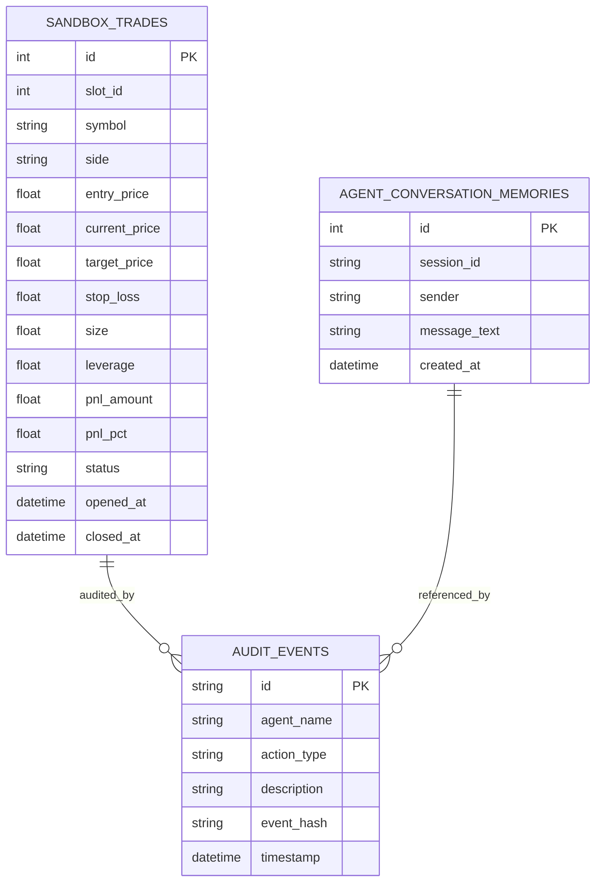

# 05 - SCHEMA DO BACKEND, DADOS & APIS MOBILE - 1CRYPTEN

> **Regra de Ouro**: A construcao do backend deve seguir contratos de API estritos, tipos primitivos definidos, persistencia confiavel em SQLite (modo WAL) e auditoria criptografica com hash SHA-256.

---

## 1. Modelagem de Dados Relacional (SQLite WAL)



---

## 2. Dicionario de Tabelas

### 2.1. `sandbox_trades` (Ordens e Slots OKX)
| Campo | Tipo | Obrigatorio | Descricao / Regra |
|---|---|---|---|
| `id` | `INTEGER` | Sim | Identificador unico auto-incremento |
| `slot_id` | `INTEGER` | Sim | Slot da ordem (1 a 4) |
| `symbol` | `VARCHAR(30)` | Sim | Par nativo OKX SWAP (ex: `DOGE-USDT-SWAP`) |
| `side` | `VARCHAR(10)` | Sim | `BUY` (Long) ou `SELL` (Short) |
| `entry_price` | `FLOAT` | Sim | Preco exato de execucao na OKX |
| `current_price` | `FLOAT` | Sim | Ultimo preco recebido no feed |
| `target_price` | `FLOAT` | Sim | Alvo (+5.0% alavancado a 15X) |
| `stop_loss` | `FLOAT` | Sim | Stop loss cirurgico (-2.5% alavancado a 15X) |
| `leverage` | `FLOAT` | Sim | Alavancagem fixa padrao (15.0) |
| `pnl_amount` | `FLOAT` | Sim | Lucro/Prejuizo flutuante em USDT |
| `pnl_pct` | `FLOAT` | Sim | Retorno percentual sobre a margem |
| `status` | `VARCHAR(20)` | Sim | `OPEN`, `CLOSED_PROFIT`, `CLOSED_STOP`, `CLOSED_MANUAL` |
| `opened_at` | `TIMESTAMP` | Sim | Data e hora de abertura |

### 2.2. `agent_conversation_memories` (Memoria do Hermes)
| Campo | Tipo | Obrigatorio | Descricao |
|---|---|---|---|
| `id` | `INTEGER` | Sim | Identificador unico |
| `session_id` | `VARCHAR(50)` | Sim | Identificador da sessao (padrao: `mobile_operator`) |
| `sender` | `VARCHAR(30)` | Sim | `User` ou `Hermes` |
| `message_text` | `TEXT` | Sim | Texto sanitizado e livre de emojis |
| `created_at` | `TIMESTAMP` | Sim | Data e hora de envio |

---

## 3. Endpoints REST e Contratos da API Mobile

### 3.1. Servico da Pagina Mobile
- **`GET /mobile`**:
  - Retorna o arquivo `backend/app/static/mobile_app.html` com viewport meta tag e configuracao PWA.

### 3.2. Visao Geral Consolidada (Home & Cockpit)
- **`GET /api/v1/mobile/overview`**:
  - Resposta JSON:
    ```json
    {
      "bankroll": {
        "total_equity": 10480.00,
        "available_margin": 8480.00,
        "daily_pnl_usd": 480.00,
        "daily_pnl_pct": 4.80,
        "winrate_pct": 82.5,
        "status_okx": "ONLINE"
      },
      "active_slots_count": 4,
      "slots": [
        {"slot_id": 1, "symbol": "DOGE-USDT-SWAP", "side": "BUY", "pnl_pct": 3.4, "status": "OPEN"},
        {"slot_id": 2, "symbol": "PEPE-USDT-SWAP", "side": "BUY", "pnl_pct": 1.8, "status": "OPEN"},
        {"slot_id": 3, "symbol": "SOL-USDT-SWAP",  "side": "BUY", "pnl_pct": 4.2, "status": "OPEN"},
        {"slot_id": 4, "symbol": "BTC-USDT-SWAP",  "side": "BUY", "pnl_pct": -0.5, "status": "OPEN"}
      ],
      "laya": {
        "pulse": "ACTIVE",
        "regime": "TENDENCIA_ALTA",
        "adx": 32.4
      }
    }
    ```

### 3.3. Dados do Grafico Solo
- **`GET /api/v1/trading/candles?symbol={symbol}&timeframe=15m`**:
  - Retorna array ordenado de candles: `[ { "time": 1727520000, "open": 0.12, "high": 0.125, "low": 0.119, "close": 0.124 } ]`.

### 3.4. Chat Conversacional com Hermes
- **`POST /api/v1/hermes/chat`**:
  - Payload: `{ "message": "Como estao os slots da Laya?", "session_id": "mobile_operator" }`
  - Resposta JSON:
    ```json
    {
      "reply": "Jonatas, a Laya gerencia 4 slots ativos na OKX. Slot 1 (DOGE) e Slot 3 (SOL) lideram com +3.4% e +4.2%. A exposicao total da banca esta dentro do limite de risco de 15X.",
      "active_agent": "hermes",
      "source": "hermes_orchestrator"
    }
    ```

### 3.5. Encerramento de Posicao (Aba Custodia e MCP)
- **`POST /api/v1/mobile/close-slot`**:
  - Payload: `{ "slot_id": 2, "symbol": "PEPE-USDT-SWAP" }`
  - Processamento: Valida integridade, fecha ordem no sandbox/OKX, gera `AuditEvent` com SHA-256 e retorna confirmacao.
