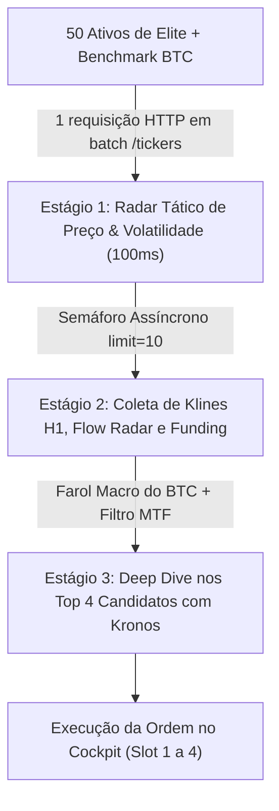

# 🏛️ Estratégia Canônica: Universo de 50 Ativos de Elite Institucional & Funil em 3 Estágios (V158)

> **Status:** Ativo / Fonte Canônica de Verdade no Segundo Cérebro (RAG)
> **Data:** 15 de Outubro de 2026
> **Responsável:** Laya Sovereign Brain / 1Crypten 7.0

---

## 1. Visão Geral e Princípio de Exclusão

O 1Crypten opera com foco estrito em **Alpha Institucional**: análise de absorção de liquidez por baleias, Delta de Open Interest (OI) e Long/Short Account Ratio da OKX Rubik cruzados com previsões neurais autoregressivas do Kronos-mini.

### Diretriz Inegociável de Filtragem:
- **Zero Memecoins**: Banimento permanente de tokens sem valor intrínseco ou movidos a especulação social (`DOGE`, `SHIB`, `PEPE`, `FLOKI`, `BONK`, `WIF`, `PENGU`, `TRUTH`, `FARTCOIN`, `WAL`, `TURBO`, `POPCAT`, `MOG`, `BRETT`, `USELESS`, `CASHCAT`, `MUBARAK`, `TRUMP`, `WLFI`).
- **Zero Tokens de Pó**: Exclusão mandatória de ativos com preço inferior a $0.05 ou spreads microscópicos manipuláveis.
- **Liquidez Mínima**: Apenas contratos com volume diário na OKX superior a **$3.000.000 USD**.

---

## 2. A Cesta Oficial dos 50 Ativos de Elite

A cesta monitorada é composta por 50 ativos distribuídos estrategicamente em 5 setores:

| Setor | Qtd | Ativos Oficiais |
| :--- | :---: | :--- |
| **Layer 1 Consagradas & Bluechips** | 15 | `ETH`, `SOL`, `AVAX`, `SUI`, `NEAR`, `ADA`, `XRP`, `DOT`, `APT`, `SEI`, `HBAR`, `ALGO`, `TON`, `ATOM`, `LTC` |
| **Layer 2 & Execução** | 8 | `ARB`, `OP`, `POL` (MATIC), `STRK`, `MNT`, `METIS`, `BLAST`, `ZK` |
| **DeFi, Oráculos & Liquidez** | 12 | `LINK`, `UNI`, `AAVE`, `MKR`, `SNX`, `CRV`, `LDO`, `PYTH`, `ONDO`, `INJ`, `PENDLE`, `DYDX` |
| **IA, DePIN & Big Data** | 10 | `RENDER`, `FET` (ASI), `GRASS`, `FIL`, `TIA`, `ICP`, `AR`, `THETA`, `JASMY`, `AKT` |
| **Gaming, Metaverso & Web3** | 5 | `SAND`, `MANA`, `AXS`, `GALA`, `CHZ` |

---

## 3. Arquitetura do Funil de Execução em 3 Estágios

Para monitorar 50 ativos de forma ultrarrápida sem causar sobrecarga de rede ou bloqueio por rate-limit (HTTP 429) na OKX:

1. **Estágio 1 (Batch Tickers)**: Uma única requisição `GET /api/v5/market/tickers?instType=SWAP` mapeia preços reais, máximas e mínimas 24h e variações percentuais de todos os 50 pares simultaneamente, incluindo `BTCUSDT`.
2. **Estágio 2 (Coleta Controlada por Semáforo)**: As chamadas pesadas (`get_klines`, `get_flow_radar`, `get_funding_rate`) são executadas com concorrência regulada (`asyncio.Semaphore(10)`), terminando a varredura completa em menos de 2 segundos.
3. **Estágio 3 (Deep Dive & Confluência Kronos)**: Apenas os 4 ativos com setups técnicos mais convergentes recebem o scoring de convicção neural do Kronos.

---

## 4. O Farol Macro do Bitcoin (Trend Alignment Shield)

- O Bitcoin (`BTCUSDT`) é monitorado como **direcional supremo de mercado**.
- **Regra de Proteção de Capital**:
  - Quando o BTC estiver em tendência de queda (`btc_trend_bias < -0.3%`), **compras (LONG) de repique de curto prazo (`LAYA_DVWAP_REVERSION`) são terminantemente bloqueadas**.
  - O sistema autoriza exclusivamente operações alinhadas ao fluxo vendedor (**SHORT**), eliminando o risco de "pegar faca caindo".
